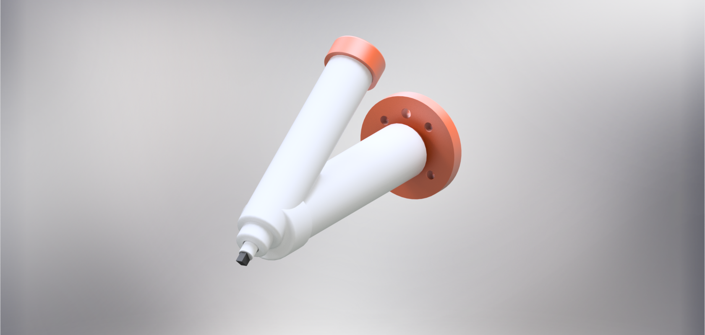
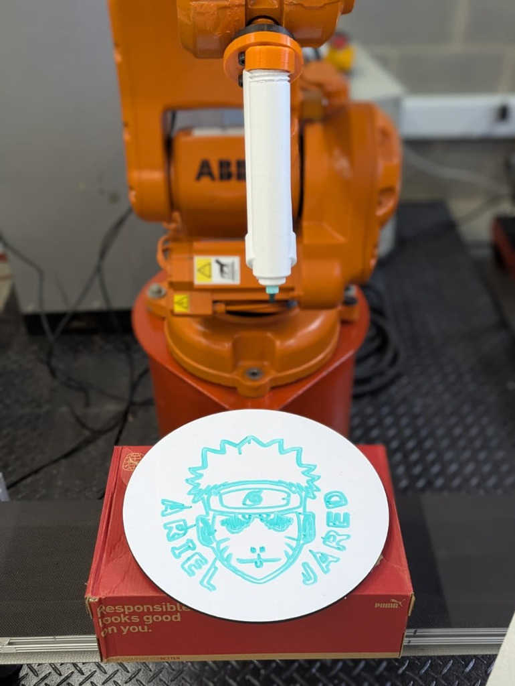
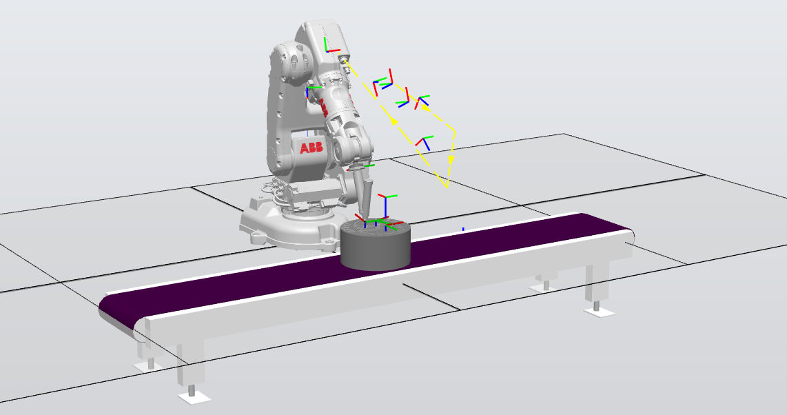
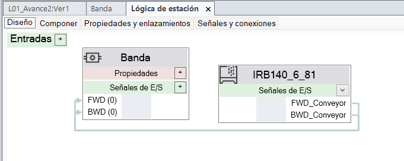
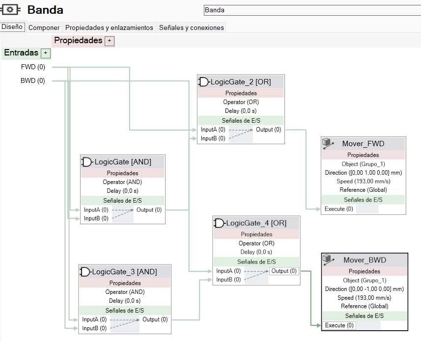
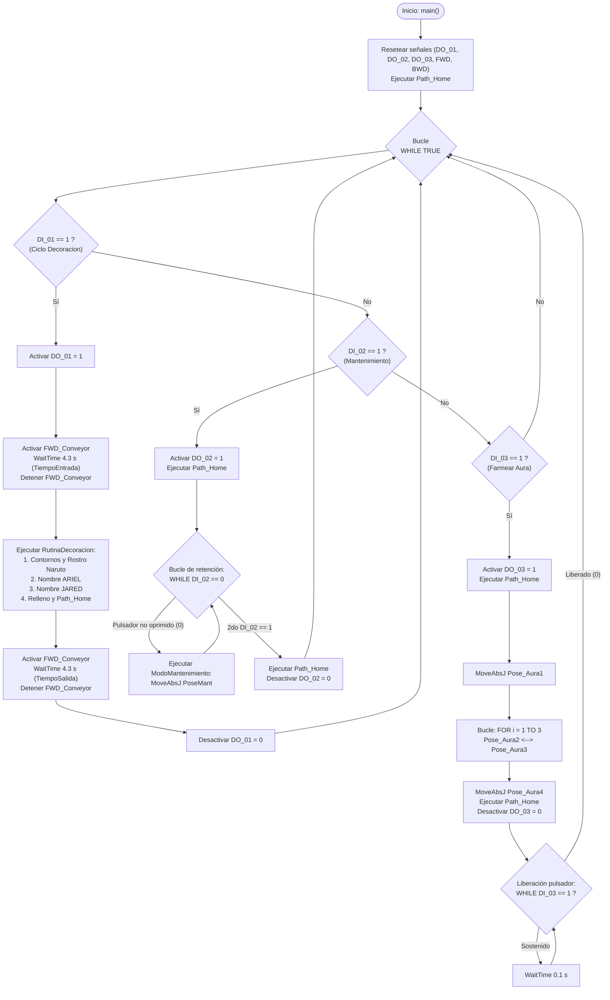
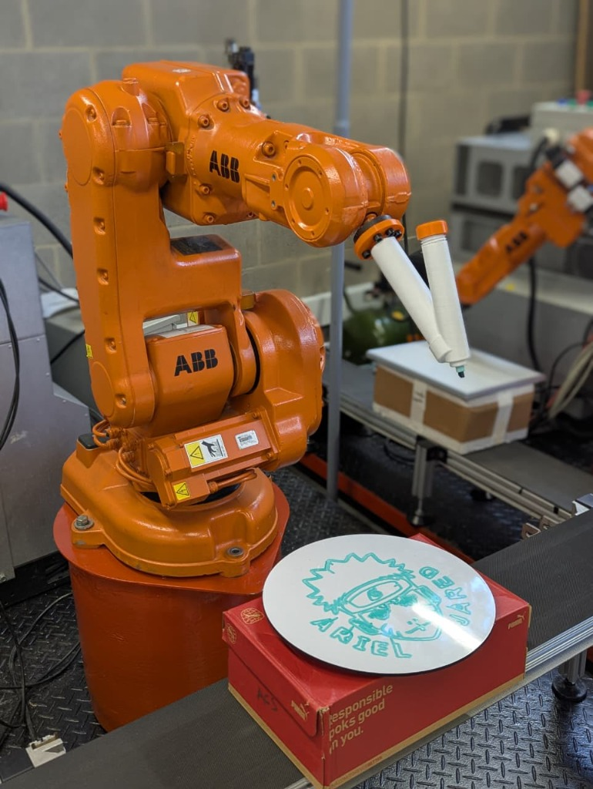
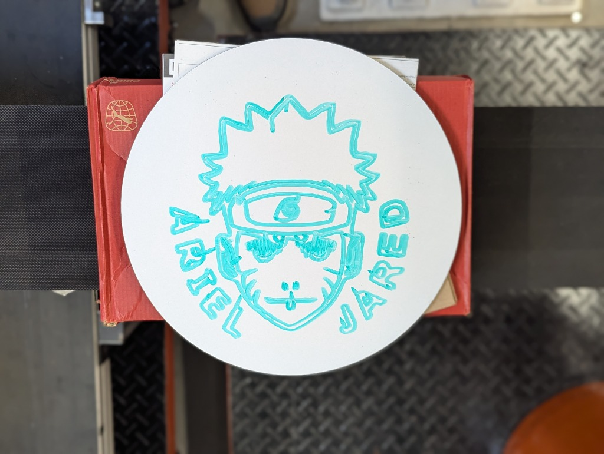
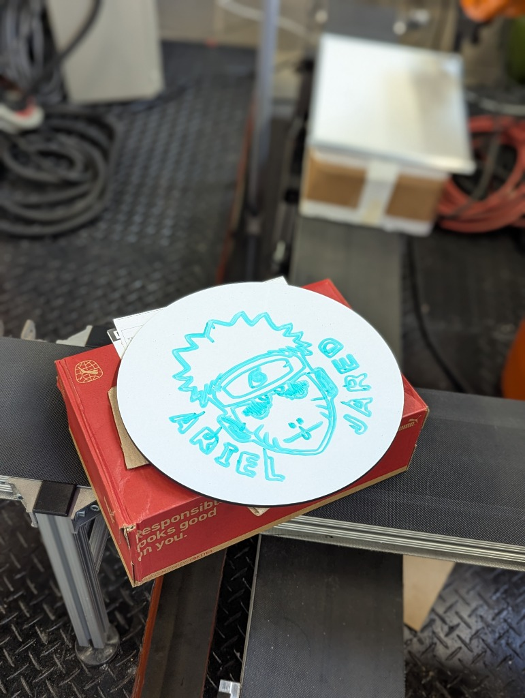

# Laboratorio 1 — Robótica Industrial: Trayectorias, Entradas y Salidas Digitales
### ABB IRB 140 · RobotStudio · RAPID · IRC5

<div align="center">

[](#)
[](#)
[](#)
[](#)

**Universidad Nacional de Colombia — Sede Bogotá**  
**Facultad de Ingeniería · Departamento de Ingeniería Mecánica y Mecatrónica**  
**Asignatura:** Robótica (2026-II)  
**Grupo 5B:** Ariel Giovanni Cadenas Santisteban · Kennet Jared Cruz Machuca

</div>

---

## Índice
1. [Descripción de la solución](#1-descripción-de-la-solución)
2. [Objetivos alcanzados](#2-objetivos-alcanzados)
3. [Estructura del directorio](#3-estructura-del-directorio)
4. [Diseño del portamarcador](#4-diseño-del-portamarcador)
5. [Calibración de TCP, WorkObjects y trayectorias](#5-calibración-de-tcp-workobjects-y-trayectorias)
6. [Lógica de control y programa RAPID](#6-lógica-de-control-y-programa-rapid)
7. [Resultados y video demostrativo](#7-resultados-y-video-demostrativo)
8. [Aprendizajes y dificultades](#8-aprendizajes-y-dificultades)
9. [Instrucciones de reproducción](#9-instrucciones-de-reproducción)

---

## 1. Descripción de la solución

En esta práctica se automatizó la rutina de decoración de un pastel (representado físicamente mediante una superficie de pizarra redonda en la celda robótica), utilizando el manipulador industrial **ABB IRB 140** (denominado **Abel** en la celda del laboratorio) controlado por la unidad **IRC5** y sincronizado con una **banda transportadora** gobernada externamente por un variador de frecuencia.

La tarea de decoración se diseñó de forma conjunta por el equipo y comprende:
- **Trazado perimetral:** Escritura continua de los nombres de los integrantes (**Ariel** y **Jared**) distribuidos a lo largo del borde circular de la pizarra.
- **Trazado central:** Ilustración del rostro de **Naruto** en el centro de la superficie circular.
- **Modos de operación:** Implementación de tres rutinas independientes seleccionadas mediante las entradas digitales del módulo DSQC 652:
  1. **`DI_01` — Ciclo automático de decoración:** Ingreso del pastel sobre la banda transportadora, detención en la estación de trabajo, ejecución de las trayectorias de dibujo por parte del robot y evacuación del producto terminado hacia el final de la banda.
  2. **`DI_02` — Pose de mantenimiento:** Desplazamiento seguro del robot a una posición accesible para inspección, ajuste o cambio del marcador.
  3. **`DI_03` — Rutina *Farmear Aura*:** Movimiento libre desarrollada por el equipo como componente creativo y de verificación cinemática.

---

## 2. Objetivos alcanzados

- Diseñar y acoplar mecánicamente un portamarcador funcional al flange del manipulador ABB IRB 140.
- Calibrar la herramienta tanto en el entorno virtual de **RobotStudio** como en el robot real usando el método de 4 puntos en el Teach Pendant.
- Definir y calibrar (tanto físico como virtualmente) el sistema de coordenadas de trabajo (**WorkObject**) sobre la superficie circular de trabajo.
- Programar la secuencia modular en lenguaje **RAPID**, implementando trayectorias lineales (`MoveL`), articulares (`MoveJ`, `MoveAbsJ`) y control de aproximación/zona (`fine`, `z10`).
- Integrar las señales de entrada y salida digitales para coordinar el movimiento bidireccional de la banda transportadora (`FWD_Conveyor`, `BWD_Conveyor`) y la señalización de estado del robot (`DO_01`, `DO_02`, `DO_03`).
- Validar la seguridad y prevención de colisiones mediante enclavamientos lógicos en RAPID antes de la ejecución en la celda física.

---

## 3. Estructura del directorio

La organización de los archivos asociados a este laboratorio es la siguiente:

```text
Laboratorio No. 01 - Robótica Industrial ABB IRB140 y RobotStudio/
├── README.MD               # Documentación principal de la práctica
├── CAD/                    # Modelos geométricos de la herramienta (formato .SAT)
├── RAPID/                  # Código fuente del programa (.mod y .txt)
└── Resultados/             # Fotografías, capturas y evidencias de la celda y simulación
```

---

## 4. Diseño del portamarcador

Para ejecutar el trazado sobre la pizarra redonda sin dañar el marcador ni comprometer la precisión de la trayectoria, se diseñó un soporte portaherramienta acoplable al plato portaherramientas (flange) del ABB IRB 140.

Para su manufactura, se consultó la hoja de datos del manipulador para extraer los patrones de medida y tolerancias del patrón de orificios del *flange* mecánico. Con base en las medidas reales, se diseñó la geometría en software CAD y se fabricó mediante impresión 3D en PLA. Para facilitar el montaje y desmontaje en el laboratorio, se seleccionó una unión roscada entre la base atornillada y el tubo principal del portamarcador, garantizando un acople adecuado que permita extraer el marcador fácilmente.

- **Archivo CAD:** El modelo en formato SAT se encuentra alojado en [`CAD/`](./CAD/).
- **Características de la herramienta:**

| Parámetro | Detalle / Valor |
|---|---|
| Tipo de acople | Flange estándar ABB IRB 140 |
| Mecanismo de sujeción | Prisionero / Ajuste mecánico para marcador |
| Formato disponible | `.SAT` |
| Masa aproximada | *[0,14 kg]* |
| Material de fabricación | *[PLA]* |

<div align="center">
  <br>
  <em>Figura 4.1: Renderizado del portamarcador inclinado con ensamble de marcador y soporte.</em>
</div><br>

<div align="center">
  <br>
  <em>Figura 4.2: Portamarcador acoplado al flange del ABB IRB 140 sobre la estación de trabajo.</em>
</div><br>

---

## 5. Calibración de TCP, WorkObjects y trayectorias

### 5.1 Tool Center Point (TCP): Calibración y comparación real vs. virtual

La calibración física del efector final se realizó en la celda mediante el Teach Pendant del IRC5 empleando el método de aproximación por 4 puntos a una referencia cónica fija (módulo `TCP_aaa`). En RobotStudio, el TCP virtual se obtuvo directamente a partir de las coordenadas del modelo CAD acoplado al flange del manipulador (`MyNewTool`).

**Poses de referencia registradas en el robot real:**
- `pTCP_Point1`: `[487.088, -198.331, 348.189] mm`
- `pTCP_Point2`: `[474.836, -270.364, 329.537] mm`
- `pTCP_Point3`: `[669.161, -210.049, 389.863] mm`
- `pTCP_Point4`: `[621.806, -39.513, 295.814] mm`

**Comparativa dimensional entre el TCP real y el TCP virtual:**

| Parámetro | Real (`tooldata aaa`) | Virtual (`tooldata MyNewTool`) | Desviación (Virtual − Real) |
|---|:---:|:---:|:---:|
| **Posición X [mm]** | `8.321` | `8.526` | `+0.205` |
| **Posición Y [mm]** | `5.401` | `1.820` | `-3.581` |
| **Posición Z [mm]** | `200.110` | `195.145` | `-4.965` |
| **Distancia entre TCPs [mm]** | — | — | **`6.125`** |
| **Orientación Cuaternión `[q1, q2, q3, q4]`** | `[1.0, 0.0, 0.0, 0.0]` | `[0.965926, 0.0, 0.258819, 0.0]` | Rotación de 30° en Y |
| **Masa nominal [kg]** | `1.0` | `1.0` | `0.0` |

**Análisis de discrepancias del TCP:**
- **Precisión dimensional:** La diferencia entre ambos puntos de referencia es de **`6.125 mm`**, concentrándose la mayor variación en los ejes Y (`-3.58 mm`) y Z (`-4.96 mm`). Esta diferencia se atribuye a dos factores principales: en primer lugar, a la apreciación visual durante la alineación manual a la punta en los 4 puntos de aproximación en el laboratorio, y en segundo lugar, a las tolerancias dimensionales del soporte impreso en 3D y el ajuste mecánico del marcador (El porta marcador contaba con cierta capacidad de retracción debido a su resorte interno, lo que dificultaba la obtención de un punto de contacto preciso y repetible).

---

### 5.2 WorkObjects: Definición y comparación real vs. virtual

En la celda real se calibró un único plano de trabajo correspondiente a la superficie donde reposaba la pizarra sobre la caja de zapatos (`Wobj_aaaa`), empleando el método de 3 puntos en el FlexPendant (`X1 = [698.54, 109.29, 191.90] mm`, `X2 = [523.93, 116.94, 181.87] mm` y `Y1 = [690.99, -120.22, 187.64] mm`).

En RobotStudio se utilizaron dos WorkObjects virtuales:
- **`Workobject_1` (Superficie física de trabajo):** Modela la estación de trabajo simulando un cilindro con el radio de la pizarra redonda montado sobre la caja. Es la contraparte virtual directa de la calibración física.
- **`Cara` (Marco del dibujo):** No se calibró de forma independiente en el robot real; se definió en RobotStudio centrado sobre el pastel para albergar la geometría importada de Naruto y asociar las trayectorias de los nombres (**Ariel** y **Jared**).

| WorkObject | Origen `[X, Y, Z]` (mm) | Cuaternión `[q1, q2, q3, q4]` | Tipo / Entorno | Función principal |
|---|:---:|:---:|:---:|---|
| **Real (`Wobj_aaaa`)** | `[700.78, 109.19, 192.03]` | `[0.02, -0.03, -0.01, 1.00]` | Físico (Robot real) | Plano medido en la celda sobre la caja y pizarra |
| **`Workobject_1`** | `[472.14, 2.80, 186.50]` | `[0.0, 0.57, 0.82, 0.0]` | Virtual (RobotStudio) | Abstracción cilíndrica de la base y pizarra |
| **`Cara`** | `[540.23, 0.02, 186.50]` | `[0.0, 0.71, 0.71, 0.0]` | Virtual (RobotStudio) | Marco centrado para el trazado de Naruto y los nombres |

**Comparación entre lo real y lo virtual:**
- **Altura de la superficie:** La altura medida en el robot real fue de `192.0 mm` y en el modelo virtual de `186.5 mm`. La diferencia es de solo **`5.5 mm`**, lo que muestra que el plano virtual y el montaje físico de la caja con la pizarra sobre la banda estaban prácticamente a la misma altura.
- **Orientación del eje Z:** En la calibración física, el eje Z queda apuntando hacia arriba (saliendo de la superficie), mientras que en RobotStudio se orientó hacia abajo (apuntando hacia la mesa) para alinearlo con la aproximación del marcador. Por eso los marcos presentan un giro de casi 180° entre sí.
- **Posición del origen:** En el laboratorio los 3 puntos se tomaron en los bordes accesibles de la superficie, mientras que en RobotStudio el origen se ubicó en el centro del pastel para facilitar el diseño y centrado del dibujo.


### 5.3 Metodología de generación y ajuste de trayectorias (CAD a RobotStudio y cinemática)

Para lograr el trazado preciso del rostro de Naruto y los nombres sin incurrir en colisiones o singularidades, se implementó el siguiente flujo de trabajo:

1. **Selección y preparación gráfica:** Se seleccionó una imagen del rostro de Naruto desde internet. Se incrementó la saturación y el contraste para destacar los trazos de color negro y se procedió a la vectorización de los bordes.
2. **Modelado CAD (Autodesk Fusion 360):** El archivo vectorial se importó en Fusion 360, donde se escaló a las proporciones de la pizarra circular, se centró respecto al origen y se generó un sólido extruido de pocos milímetros de espesor. Con la misma metodología se modelaron las letras para los nombres de los integrantes (**ARIEL** y **JARED**).
3. **Exportación e importación en RobotStudio:** Los sólidos se exportaron en formato `.SAT`. Al importarse en RobotStudio, las piezas conservaban el sistema de referencia por defecto proveniente del entorno CAD; este marco fue trasladado geométricamente para posicionar y alinear de forma inmediata los sólidos sobre el WorkObject correspondiente (`Cara`).
4. **Definición de trayectorias con Auto-Path:** Se seleccionaron los contornos cerrados del sólido; la herramienta *Auto-Path* de RobotStudio calculó los puntos de paso (`targets`) y los enlazó automáticamente en trayectorias continuas.
5. **Corrección de alcanzabilidad cinemática (*Target Unreachable*):**
   - *Problema de orientación de los marcos de referencia:* Por defecto, *Auto-Path* asignaba orientaciones arbitrarias y dispares a los ejes de referencia a lo largo de las curvas, ocasionando errores donde el robot no podía alcanzar los puntos debido a límites articulares del manipulador.
   - *Solución (Homogeneización de marcos):* Se configuró un marco de referencia con una orientación similar a la de la herramienta (`MyNewTool`) en posición de trabajo, y se replicó dicha orientación homogéneamente a todos los puntos de la trayectoria.
   - *Problema en puntos críticos cercanos a la base:* En las curvas más próximas a la base del manipulador (como el contorno de la barbilla de Naruto), persistían errores de alcanzabilidad cinemática.
   - *Solución (Rotación angular en el eje Y):* Se rotaron los marcos de referencia de dichos puntos críticos alrededor de su eje local **Y** entre **5° y 15°** (aplicando 15° a los puntos más cercanos al robot). Esta ligera inclinación facilitó la aproximación cinemática del brazo sin perder el contacto del marcador sobre la pizarra.

Para simular la celda automatizada en RobotStudio y validar el transporte del pastel previa ejecución física, se configuró un **Smart Component** dedicado a la banda transportadora (`Banda`).

<div align="center">
  <br>
  <em>Figura 5.1: Vista del entorno de simulación en RobotStudio con el robot ABB IRB 140, la herramienta y la banda.</em>
</div><br>

#### 5.4 Arquitectura de control y enlazamiento de señales:

1. **Lógica de Estación (Conexión de Señales E/S):**
   En la pestaña *Señales y conexiones* de la Lógica de Estación, se vincularon directamente las salidas digitales del controlador del robot `IRB140_6_81` hacia las entradas del Smart Component de la banda:
   - `IRB140_6_81 / FWD_Conveyor` $\rightarrow$ `Banda / FWD`
   - `IRB140_6_81 / BWD_Conveyor` $\rightarrow$ `Banda / BWD`

<div align="center">
  <br>
  <em>Figura 5.2: Tabla de conexiones entre las salidas de control del manipulador y las entradas digitales de la banda.</em>
</div><br>

2. **Estructura interna del Smart Component (`Diseño` / `Componer`):**
   En el panel interno del Smart Component, la señal de avance o retroceso interactúa con dos actuadores de movimiento lineal (`Mover_FWD` a $+Y$ y `Mover_BWD` a $-Y$ con velocidad de $193\text{ mm/s}$ escogida según el tiempo de operación de la banda que son 4,3 segundos aproximadamente).
   - **Procesamiento mediante compuertas lógicas:** Las entradas `FWD` y `BWD` se ramifican hacia una red de compuertas `AND` (`LogicGate`, `LogicGate_3`) y `OR` (`LogicGate_2`, `LogicGate_4`).
   - **Enclavamiento dinámico:** Aunque en el flujo principal del simulador el movimiento lineal lo desencadenan directamente los comandos de RAPID, la presencia de esta red de compuertas internamente cumple la función de enclavamiento de seguridad para evitar habilitar ambos motores lineales en sentido opuesto en la simulación.

<div align="center">
  <br>
  <em>Figura 5.3: Diagrama de bloques interno del Smart Component mostrando los actuadores lineales Mover_FWD/Mover_BWD y las compuertas lógicas de control.</em>
</div><br>

---

## 6. Lógica de control y programa RAPID

### 6.1 Mapeo y comportamiento de Entradas y Salidas Digitales (Módulo DSQC 652)

Las señales de entrada y salida fueron configuradas a través del módulo de E/S estándar **DSQC 652** en el controlador IRC5:

> [!NOTE]
> **Naturaleza física de las entradas:** Las entradas `DI_01`, `DI_02` y `DI_03` están conectadas a **pulsadores físicos** (contactos normalmente abiertos). Al ser accionadas, entregan un pulso transitorio (1 lógico mientras están presionadas, 0 al soltarse), lo cual determinó el diseño lógico en RAPID para enclavamiento y retención.

| Señal | Tipo | Elemento físico / Función | Comportamiento lógico en RAPID |
|---|---|---|---|
| `DI_01` | Entrada Digital | Pulsador verde / Marcha ciclo | Inicia el ciclo automático de transporte, dibujo y evacuación |
| `DI_02` | Entrada Digital | Pulsador / Mantenimiento (Toggle) | Primer pulso: entra y retiene pose `PoseMant`. Segundo pulso: sale y retorna a Home |
| `DI_03` | Entrada Digital | Pulsador / Rutina libre | Inicia la coreografía articular *Farmear Aura* |
| `DO_01` | Salida Digital | Luz piloto / Indicador Decoración | Activa (`1`) durante todo el ciclo de decoración y movimiento de entrada/salida de la banda |
| `DO_02` | Salida Digital | Luz piloto / Indicador Mantenimiento | Activa (`1`) mientras el robot se mantenga retenido en la pose de mantenimiento |
| `DO_03` | Salida Digital | Luz piloto / Indicador Farmear Aura | Activa (`1`) durante la ejecución de la coreografía *Farmear Aura* |
| `FWD_Conveyor` | Salida Digital | Relé mando / Avance banda | Comanda el avance de la banda transportadora hacia el robot |
| `BWD_Conveyor` | Salida Digital | Relé mando / Reversa banda | Comanda el retroceso de la banda transportadora (utilizado en `RutinaVuelta`) |

> [!NOTE]
> **Accionamiento de la banda y particularidades de las celdas ("Abel" vs. "Caín"):**
> Las bandas transportadoras de la celda son sistemas periféricos totalmente **independientes del manipulador**; no están acopladas cinemáticamente al IRC5 ni constituyen un grado de libertad adicional del robot, sino que se controlan mediante un **variador de frecuencia externo** comandado a través de las salidas digitales del módulo DSQC 652.
>
> Debido a que las celdas del laboratorio se implementaron en distintos momentos y con recursos diferentes, presentan filosofías de control distintas:
> - **Celda "Caín":** La señal `FWD` se utiliza como habilitador general de marcha (`Run/Stop`) y la segunda señal conmuta el sentido de giro (`Dirección`).
> - **Celda "Abel" (utilizada en esta práctica):** Maneja señales independientes de marcha para avance (`FWD_Conveyor`) y reversa (`BWD_Conveyor`). En esta celda, el variador y el controlador real ya incorporaban un enclavamiento por hardware por defecto que impedía la activación simultánea de ambos sentidos.
>
> **Enclavamiento redundante por software en RAPID:** A pesar de que en "Abel" el hardware ya protegía la inversión de marcha de forma predeterminada, se mantuvo la lógica de enclavamiento explícito en el código RAPID (asegurando el apagado preventivo de una señal antes de activar la opuesta). Esta redundancia garantiza buenas prácticas de programación industrial, inmunidad ante fallas de configuración del variador y portabilidad del código entre celdas.

#### Detalle de operación por modos:

- **Modo 1: Ciclo de Decoración (`DI_01` / `DO_01`):**
  Al pulsar `DI_01`:
  1. Se enciende el indicador visual `DO_01 = 1`.
  2. Se activa el avance de la banda `FWD_Conveyor = 1` durante `TiempoEntrada = 4.3 s` para ingresar el pastel hasta la posición de trabajo, tras lo cual se detiene (`RESET FWD_Conveyor`).
  3. Se ejecuta `RutinaDecoracion()`, que traza ordenadamente el contorno del rostro, cabello, facciones, banda ninja, los nombres **ARIEL** y **JARED**, y el sombreado final. Entre secciones, la herramienta sube a `Target_Pausa` (`Z = -35.3 mm`) mediante `Path_Pausa()` para evitar rayaduras accidentales.
  4. Se reactiva `FWD_Conveyor = 1` durante `TiempoSalida = 4.3 s` para evacuar el pastel terminado hacia el extremo de descarga.
  5. Se apaga el indicador `DO_01 = 0`.

- **Modo 2: Pose de Mantenimiento (`DI_02` / `DO_02`):**
  Al ser `DI_02` un pulsador momentáneo, se implementó una rutina de retención lógica:
  1. Al presionar `DI_02` por primera vez (`DI_02 = 1`), se activa `DO_02 = 1` y el robot va a `Path_Home`.
  2. Al liberarse el pulsador, `DI_02` vuelve a `0`, entrando al ciclo:
     ```rapid
     WHILE DI_02 = 0 DO
         ModoMantenimiento;
     ENDWHILE
     ```
     En este estado, el manipulador ejecuta continuamente `MoveAbsJ PoseMant, v200, fine, MyNewTool`, permaneciendo inmóvil en la pose articular accesible `PoseMant` (`[-30°, -10°, 10°, 0°, 30°, 0°]`) para inspección o cambio de marcador.
  3. Cuando el operador presiona el pulsador `DI_02` por segunda vez (`DI_02 = 1`), la condición `DI_02 = 0` se rompe, el robot sale del bucle, ejecuta `Path_Home` y apaga el testigo `DO_02 = 0`.

- **Modo 3: Coreografía *Farmear Aura* (`DI_03` / `DO_03`):**
  1. Al recibir el pulso en `DI_03`, se resetean las demás salidas y se enciende `DO_03 = 1`.
  2. El robot ejecuta `FarmearAura`: realiza una transición hacia `Pose_Aura1`, ejecuta un ciclo iterativo `FOR i FROM 1 TO 3 DO` oscilando entre `Pose_Aura2` y `Pose_Aura3`, se desplaza a `Pose_Aura4`, retorna a `Path_Home` y apaga `DO_03 = 0`.
  3. El procedimiento finaliza con una instrucción de espera `WHILE DI_03 = 1 DO WaitTime 0.1; ENDWHILE`, asegurando que si el usuario mantiene el pulsador presionado, no se reinicie la rutina hasta que este sea liberado.

### 6.2 Arquitectura modular del programa

El programa RAPID ([`Module1.mod`](./RAPID/Module1.mod)) se estructuró de manera modular para facilitar su mantenimiento y depuración:

- **`main()`**: Módulo principal de supervisión que inicializa las salidas a cero (`Reset`), envía el robot a `Path_Home` y gestiona el bucle infinito `WHILE TRUE DO` para el sondeo de los pulsadores de entrada.
- **`RutinaDecoracion()`**: Secuencia lineal de 35 trayectorias de dibujo con interpolación lineal (`MoveL`) y articular (`MoveJ`). Aplica elevación intermedia con `Path_Pausa()` a `Target_Pausa` entre cada trazo:
  - *Rostro de Naruto:* `Path_ContornoExterno`, `Cabello`, `ContornoCara`, `Frente`, `Boca`, `BandaNinja`, `SimboloNinja`, orejas (1 y 2 para derecha e izquierda) y detalles 1 al 7.
  - *Nombre Ariel:* `Path_Nombre1_A1`, `A2`, `R1`, `R2`, `I`, `E`, `L`.
  - *Nombre Jared:* `Path_Nombre2_J`, `A1`, `A2`, `R1`, `R2`, `E`, `D1`, `D2`.
  - *Pintado final:* `Path_Pintar1`, `Path_Pintar2`.
- **`ModoMantenimiento()`**: Desplazamiento articular absoluto (`MoveAbsJ`) hacia `PoseMant`.
- **`FarmearAura()`**: Rutina coreográfica creativa con 3 oscilaciones articulares completas a velocidad `v150` con zona `z1`.
- **`RutinaVuelta()`**: Rutina de retorno en reversa de la banda transportadora con `BWD_Conveyor` durante `4.3 s`.
- **`ConveyorForward()`, `ConveyorBackward()`, `ConveyorStop()`**: Módulos auxiliares de control de transporte con temporización calibrada (`TiempoEntrada = 4.3 s`, `TiempoSalida = 4.3 s`, `TiempoDeslizamiento = 3.8 s`).
- **`Path_Home()`**: Posición de reposo seguro para evitar colisiones con elementos del entorno.

### 6.3 Diagrama de flujo del sistema



---

## 7. Resultados y video demostrativo

La implementación física fue validada de forma completa en el laboratorio del LabSIR, ejecutando tanto el ciclo de transporte como el trazado real sobre la pizarra circular con el marcador.

### 7.1 Evidencias fotográficas de la implementación real

A continuación se presentan los registros fotográficos obtenidos durante las pruebas en la celda del laboratorio:

| Vista general de la celda y montaje | Detalle del trazado final |
|:---:|:---:|
|  |  |
| *Figura 7.1: Disposición del ABB IRB 140, banda transportadora y herramienta montada.* | *Figura 7.2: Resultado del trazado con los nombres Ariel, Jared y el rostro de Naruto.* |

<div align="center">
  <br>
  <em>Figura 7.3: Pastel posicionado sobre la banda transportadora al concluir el ciclo automático.</em>
</div>

### 7.2 Registro audiovisual (Canal oficial LabSIR - YouTube)

A continuación se presenta el registro audiovisual oficial de la práctica en el robot real:

<div align="center">

[](https://www.youtube.com/watch?v=vdbJv02MnJA)

*Haz clic en la imagen superior para reproducir el video en YouTube*  
**Enlace directo:** [https://www.youtube.com/watch?v=vdbJv02MnJA](https://www.youtube.com/watch?v=vdbJv02MnJA)

</div>

---

## 8. Aprendizajes y dificultades

### Aprendizajes clave
- **Flujo CAD-to-Robot en trayectorias complejas:** Comprensión práctica de la integración entre diseño 2D/3D (Fusion 360), formato de intercambio geométrico `.SAT` y generación de trayectorias en RobotStudio mediante `Auto-Path`.
- **Desacoplamiento de marcos de trabajo (WorkObjects):** La separación entre el marco de la base del robot y el WorkObject de la pieza permitió realizar traslados y calibraciones rápidas en la celda real sin tener que reprogramar los puntos individuales de dibujo.

- **Lógica de control para señales transitorias:** Implementación de enclavamientos lógicos en RAPID para adaptar pulsadores momentáneos a funciones biestables (como en la pose de mantenimiento con `DI_02`).

### Dificultades encontradas y soluciones implementadas
- **Singularidades y marcos dispares en Auto-Path (*Target Unreachable*):**
  - *Dificultad:* Al generar trayectorias sobre curvas cerradas complejas, RobotStudio creaba marcos de referencia de puntos con orientaciones aleatorias, y en zonas cercanas a la base del robot (barbilla de Naruto) se superaban los límites de alcance del manipulador.
  - *Solución:* Se unificó la orientación de todos los marcos igualándolos a la orientación de la herramienta `MyNewTool`. Para los puntos críticos de mayor proximidad, se aplicó una rotación local en el eje Y de **5° a 15°**, permitiendo una postura accesible para el manipulador sin alterar la calidad del trazo.
- **Calibración de tiempos y parada de la banda transportadora:**
  - *Dificultad:* Debido a la inercia del conjunto motor-reductor-banda y la rampa de desaceleración del variador de frecuencia, el pastel no se detenía exactamente en la posición deseada si solo se consideraba la distancia nominal.
  - *Solución:* Se realizaron calibraciones temporales empíricas en planta, determinando que `4.3 segundos` era el tiempo exacto (`TiempoEntrada` y `TiempoSalida`) para situar la base en el centro del espacio de trabajo del robot y posteriormente evacuarla.
---
