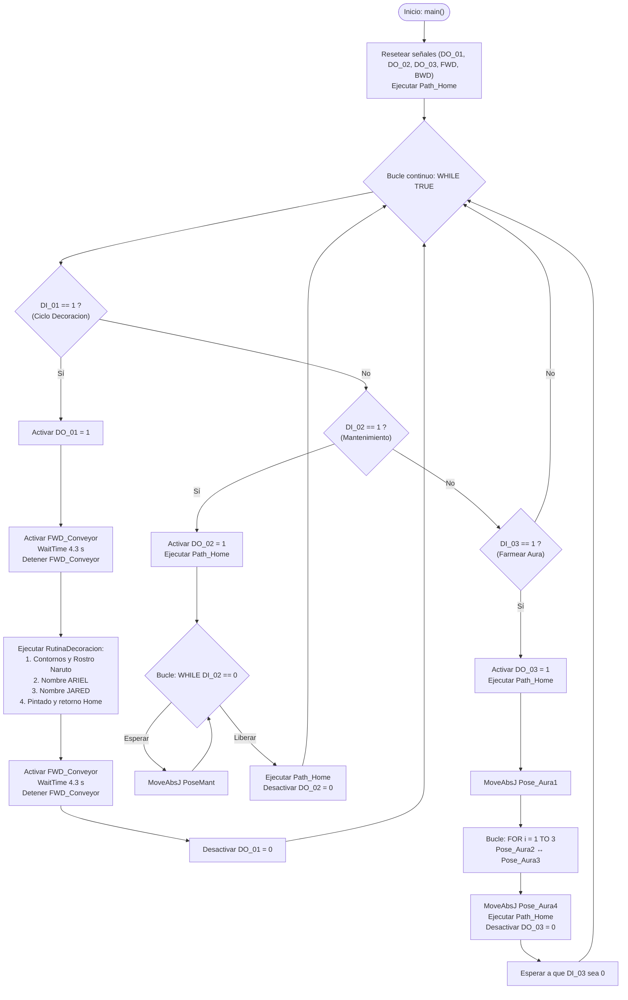

# Laboratorio 1 — Robótica Industrial: Trayectorias, Entradas y Salidas Digitales
### ABB IRB 140 · RobotStudio · RAPID · IRC5

<div align="center">

[](#)
[](#)
[](#)
[](#)

**Universidad Nacional de Colombia — Sede Bogotá**  
**Facultad de Ingeniería · Departamento de Ingeniería Mecánica y Mecatrónica**  
**Asignatura:** Robótica (2026-II)  
**Grupo 5B:** Ariel Giovanni Cadenas Santisteban · Kennet Jared Cruz Machuca

</div>

---

## Índice
1. [Descripción de la solución](#1-descripción-de-la-solución)
2. [Objetivos alcanzados](#2-objetivos-alcanzados)
3. [Estructura del directorio](#3-estructura-del-directorio)
4. [Diseño del portamarcador](#4-diseño-del-portamarcador)
5. [Calibración de TCP y WorkObject](#5-calibración-de-tcp-y-workobject)
6. [Lógica de control y programa RAPID](#6-lógica-de-control-y-programa-rapid)
7. [Resultados y video demostrativo](#7-resultados-y-video-demostrativo)
8. [Aprendizajes y dificultades](#8-aprendizajes-y-dificultades)
9. [Instrucciones de reproducción](#9-instrucciones-de-reproducción)

---

## 1. Descripción de la solución

En esta práctica se automatizó la rutina de decoración de un pastel (representado físicamente mediante una superficie de pizarra redonda en la celda robótica), utilizando el manipulador industrial **ABB IRB 140** controlado por la unidad **IRC5** y sincronizado con una **banda transportadora**.

La tarea de decoración se diseñó de forma conjunta por el equipo y comprende:
- **Trazado perimetral:** Escritura continua de los nombres de los integrantes (**Ariel** y **Jared**) distribuidos a lo largo del borde circular de la pizarra.
- **Trazado central:** Ilustración del rostro de **Naruto** en el centro de la superficie circular.
- **Modos de operación:** Implementación de tres rutinas independientes seleccionadas mediante las entradas digitales del módulo DSQC 652:
  1. **`DI_01` — Ciclo automático de decoración:** Ingreso del pastel sobre la banda transportadora, detención en la estación de trabajo, ejecución de las trayectorias de dibujo por parte del robot y evacuación del producto terminado hacia el final de la banda.
  2. **`DI_02` — Pose de mantenimiento:** Desplazamiento seguro del robot a una posición accesible para inspección, ajuste o cambio del marcador.
  3. **`DI_03` — Rutina *Farmear Aura*:** Mvimiento libre desarrollada por el equipo como componente creativo y de verificación cinemática.

---

## 2. Objetivos alcanzados

- Diseñar y acoplar mecánicamente un portamarcador funcional al flange del manipulador ABB IRB 140.
- Calibrar la herramienta tanto en el entorno virtual de **RobotStudio** como en el robot real usando el método de 4 puntos en el Teach Pendant.
- Definir y calibrar (tanto físico como virtualmente) el sistema de coordenadas de trabajo (**WorkObject**) sobre la superficie circular de trabajo.
- Programar la secuencia modular en lenguaje **RAPID**, implementando trayectorias lineales (`MoveL`), articulares (`MoveJ`, `MoveAbsJ`) y control de aproximación/zona (`fine`, `z10`).
- Integrar las señales de entrada y salida digitales para coordinar el movimiento bidireccional de la banda transportadora (`FWD_Conveyor`, `BWD_Conveyor`) y la señalización de estado del robot (`DO_01`, `DO_02`, `DO_03`).
- Validar la seguridad y prevención de colisiones mediante enclavamientos lógicos en RAPID antes de la ejecución en la celda física.

---

## 3. Estructura del directorio

La organización de los archivos asociados a este laboratorio es la siguiente:

```text
Laboratorio No. 01 - Robótica Industrial ABB IRB140 y RobotStudio/
├── README.MD               # Documentación principal de la práctica
├── CAD/                    # Modelos geométricos de la herramienta (formato .SAT)
├── RAPID/                  # Código fuente del programa (.mod y .txt)
└── Resultados/             # Fotografías y evidencias de la celda
```

---

## 4. Diseño del portamarcador

Para ejecutar el trazado sobre la pizarra redonda sin dañar el marcador ni comprometer la precisión de la trayectoria, se diseñó un soporte portaherramienta acoplable al plato portaherramientas (flange) del ABB IRB 140.

- **Archivo CAD:** El modelo en formato de intercambio se encuentra alojado en [`CAD/`](./CAD/).
- **Características de la herramienta:**

| Parámetro | Detalle / Valor |
|---|---|
| Tipo de acople | Flange estándar ABB IRB 140 |
| Mecanismo de sujeción | Prisionero / Ajuste mecánico para marcador |
| Formato disponible | `.SAT` |
| Masa aproximada | *[Completar: ej. 0.15 kg]* |
| Material de fabricación | *[Completar: ej. PLA / Impresión 3D]* |

<div align="center">
  <br>
  <em>Figura 4.1: Portamarcador acoplado al flange del ABB IRB 140 sobre la estación de trabajo.</em>
</div><br>

---

## 5. Calibración de TCP y WorkObject

### 5.1 Tool Center Point (TCP)
La calibración física del TCP se llevó a cabo en el laboratorio mediante el FlexPendant utilizando el método de aproximación por 4 puntos a una referencia fija cónica. En RobotStudio, el TCP virtual se obtuvo a partir de las coordenadas del modelo CAD acoplado al flange.

A continuación se presentan los valores nominales registrados en el módulo RAPID (`MyNewTool`):

| Parámetro TCP | Valor obtenido (`tooldata MyNewTool`) |
|---|---|
| **Posición X [mm]** | `8.526` |
| **Posición Y [mm]** | `1.820` |
| **Posición Z [mm]** | `195.145` |
| **Orientación Cuaternión `[q1, q2, q3, q4]`** | `[0.965926, 0.0, 0.258819, 0.0]` |
| **Masa nominal [kg]** | `1.0` |

### 5.2 WorkObjects (Superficies de trabajo)
Se calibraron y utilizaron dos objetos de trabajo (`wobjdata`) para desacoplar las trayectorias geométricas del marco de referencia de la base del robot:

| WorkObject | Coordenadas origen `[X, Y, Z]` (mm) | Rotación Cuaternión `[q1, q2, q3, q4]` | Función |
|---|---|---|---|
| **`Cara`** | `[540.229, 0.016, 186.500]` | `[0.0, 0.707107, 0.707107, 0.0]` | Marco de referencia principal centrado sobre el pastel para el rostro de Naruto y los nombres |
| **`Workobject_1`** | `[472.139, 2.804, 186.500]` | `[0.0, 0.573618, 0.819123, 0.0]` | Marco alterno para reubicación y pruebas de traslación |

---

## 6. Lógica de control y programa RAPID

### 6.1 Mapeo de Entradas y Salidas Digitales (Módulo DSQC 652)

| Señal | Tipo | Descripción |
|---|---|---|
| `DI_01` | Entrada Digital | Inicia el ciclo automático de transporte y decoración |
| `DI_02` | Entrada Digital | Solicita el desplazamiento a pose de mantenimiento |
| `DI_03` | Entrada Digital | Inicia la rutina coreográfica *Farmear Aura* |
| `DO_01` | Salida Digital | Activa (1) mientras el robot ejecuta la rutina de decoración |
| `DO_02` | Salida Digital | Activa (1) mientras el robot permanece en pose de mantenimiento |
| `DO_03` | Salida Digital | Activa (1) durante la ejecución de la rutina *Farmear Aura* |
| `FWD_Conveyor` | Salida Digital | Activa el avance de la banda transportadora hacia la estación |
| `BWD_Conveyor` | Salida Digital | Activa el retroceso de la banda transportadora hacia la salida |

> [!WARNING]
> **Enclavamiento de seguridad:** Para proteger el motor y el variador de frecuencia, el programa prohíbe y previene en todo momento la activación simultánea de `FWD_Conveyor = 1` y `BWD_Conveyor = 1`.

### 6.2 Arquitectura modular del programa

El código RAPID está estructurado en procedimientos especializados:

- **`main()`**: Ciclo principal de supervisión que inicializa las señales en cero (`Reset`), posiciona el robot en `Path_Home` y ejecuta un bucle continuo (`WHILE TRUE`) evaluando los modos de operación.
- **`RutinaDecoracion()`**: Coordina el trazado secuencial de contornos y detalles. Entre cada sección se llama a `Path_Pausa()` para elevar la herramienta hacia `Target_Pausa` (`Z = -35.3 mm`), evitando rayones indeseados:
  - *Rostro de Naruto:* `Path_ContornoExterno`, `Cabello`, `ContornoCara`, `Frente`, `Boca`, `BandaNinja`, `SimboloNinja`, orejas (1 y 2 para derecha e izquierda) y detalles (1 al 7).
  - *Nombres:*
    - **Ariel:** `Path_Nombre1_A1`, `A2`, `R1`, `R2`, `I`, `E`, `L`.
    - **Jared:** `Path_Nombre2_J`, `A1`, `A2`, `R1`, `R2`, `E`, `D1`, `D2`.
  - *Pintado final:* `Path_Pintar1`, `Path_Pintar2`.
- **`ModoMantenimiento()`**: Desplaza el robot mediante `MoveAbsJ` a `PoseMant` (`[-30°, -10°, 10°, 0°, 30°, 0°]`).
- **`FarmearAura()`**: Coreografía con bucle iterativo `FOR i FROM 1 TO 3` alternando entre `Pose_Aura2` y `Pose_Aura3`, con entrada y salida hacia `Pose_Aura1` y `Pose_Aura4`.
- **`ConveyorForward()`, `ConveyorBackward()`, `ConveyorStop()`**: Control del avance y reversa con tiempos de temporización calibrados (`TiempoEntrada = 4.3 s`, `TiempoSalida = 4.3 s`).

### 6.3 Diagrama de flujo del sistema



---

## 7. Resultados y video demostrativo

La implementación física fue validada de forma completa en el laboratorio del LabSIR, ejecutando tanto el ciclo de transporte como el trazado real sobre la pizarra circular con el marcador.

### 7.1 Evidencias fotográficas de la implementación real

A continuación se presentan los registros fotográficos obtenidos durante las pruebas en la celda del laboratorio:

| Vista general de la celda y montaje | Detalle del trazado final |
|:---:|:---:|
|  |  |
| *Figura 7.1: Disposición del ABB IRB 140, banda transportadora y herramienta montada.* | *Figura 7.2: Resultado del trazado con los nombres Ariel, Jared y el rostro de Naruto.* |

<div align="center">
  <br>
  <em>Figura 7.3: Pastel posicionado sobre la banda transportadora al concluir el ciclo automático.</em>
</div>

### 7.2 Registro audiovisual (Canal oficial LabSIR - YouTube)

A continuación se presenta el registro audiovisual oficial de la práctica en el robot real:

<div align="center">

[](https://www.youtube.com/watch?v=vdbJv02MnJA)

*Haz clic en la imagen superior para reproducir el video en YouTube*  
**Enlace directo:** [https://www.youtube.com/watch?v=vdbJv02MnJA](https://www.youtube.com/watch?v=vdbJv02MnJA)

</div>

---

## 8. Aprendizajes y dificultades

### Aprendizajes clave
- *[Completar con los aprendizajes técnicos específicos del equipo]*
- *[Por ejemplo: efecto del filtrado de zonas z10 vs fine en la fluidez del trazado de Naruto, repetibilidad del robot al trabajar con WorkObjects]*

### Dificultades encontradas y soluciones implementadas
- *[Completar con las dificultades reales experimentadas]*
- *[Por ejemplo: ajuste de la presión del marcador para trazo uniforme, calibración del tiempo exacto de detención de la banda transportadora con la inercia del variador]*

---

## 9. Instrucciones de reproducción