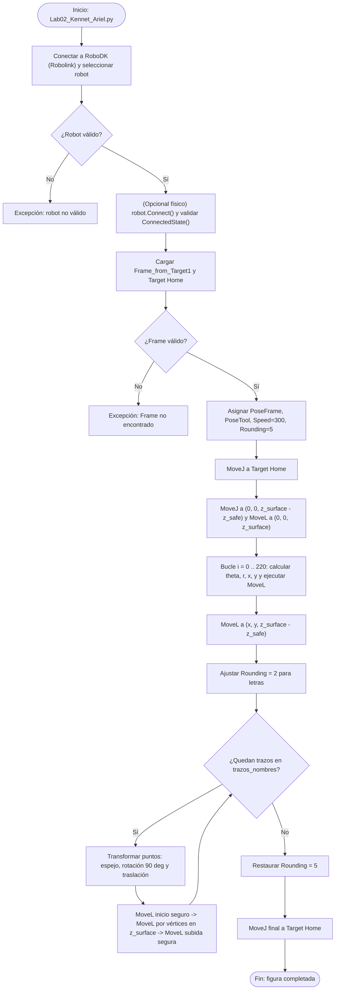

# Laboratorio 2 — Robótica Industrial: Análisis y Operación del Manipulador Motoman MH6
### Yaskawa Motoman MH6 · Controlador DX100 · RoboDK · Python API

<div align="center">

[](#)
[](#)
[](#)
[](#)

**Universidad Nacional de Colombia — Sede Bogotá**  
**Facultad de Ingeniería · Departamento de Ingeniería Mecánica y Mecatrónica · Sala CAM**  
**Asignatura:** Robótica (2026-II)  
**Grupo 5B:** Ariel Giovanni Cárdenas Santisteban · Kennet Jared Cruz Machuca

</div>

---

## Índice
1. [Descripción general y objetivos](#1-descripción-general-y-objetivos)
2. [Comparación técnica: Yaskawa Motoman MH6 vs. ABB IRB 140](#2-comparación-técnica-yaskawa-motoman-mh6-vs-abb-irb-140)
3. [Configuraciones iniciales del Motoman MH6 (home1 y home2)](#3-configuraciones-iniciales-del-motoman-mh6-home1-y-home2)
4. [Operación manual del manipulador Motoman MH6 (Teach Pendant DX100)](#4-operación-manual-del-manipulador-motoman-mh6-teach-pendant-dx100)
5. [Software RoboDK, comunicación con el MH6 y comparación con RobotStudio](#5-software-robodk-comunicación-con-el-mh6-y-comparación-con-robotstudio)
6. [Plano de planta de la celda robótica (Sala CAM)](#6-plano-de-planta-de-la-celda-robótica-sala-cam)
7. [Trayectoria polar, nombres y programación en Python](#7-trayectoria-polar-nombres-y-programación-en-python)
8. [Resultados, evidencias y video demostrativo](#8-resultados-evidencias-y-video-demostrativo)
9. [Aprendizajes, dificultades y conclusiones](#9-aprendizajes-dificultades-y-conclusiones)
10. [Referencias](#10-referencias)

---

## 1. Descripción general y objetivos

En esta práctica se desarrolla el análisis técnico, la operación manual mediante el **Teach Pendant DX100** y el control programado desde PC con **RoboDK (Python API)** del manipulador industrial **Yaskawa Motoman MH6** en el Laboratorio **Sala CAM** de la Universidad Nacional de Colombia.

*[Completar: redactar una breve descripción ejecutiva de la práctica integrando la comparación con el ABB IRB 140, la validación matemática en GeoGebra, la simulación en RoboDK y la ejecución física de la trayectoria polar junto con los nombres **KENNET** y **ARIEL**.]*

### Objetivos y resultados de aprendizaje
- Comparar las capacidades técnicas y aplicaciones del manipulador **Yaskawa Motoman MH6** frente al **ABB IRB 140**.
- Identificar y diferenciar las configuraciones articulares iniciales **`home1`** y **`home2`** del Motoman MH6.
- Ejecutar movimientos manuales en modos **articular** y **cartesiano** (traslaciones y rotaciones en $X, Y, Z$) desde el Teach Pendant DX100.
- Comprender y conmutar los niveles de velocidad manual disponibles en el controlador DX100.
- Explicar el funcionamiento de **RoboDK**, su comunicación en modo remoto con el manipulador físico y sus diferencias frente a **RobotStudio**.
- Diseñar, validar matemáticamente en **GeoGebra**, simular en **RoboDK** y ejecutar físicamente una trayectoria polar y el trazado de los nombres del equipo comandados desde Python.

### Estructura del directorio

```text
Laboratorio No. 02 - Robótica Industrial Motoman MH6 y RoboDK/
├── README.MD                 # Informe y documentación principal de la práctica
├── Python/                   # Scripts de control en Python (RoboDK API)
│   └── Lab02_Kennet_Ariel.py # Trayectoria polar y trazado de nombres
├── Estacion_RoboDK/          # *[Agregar según corresponda: archivo .rdk de la estación]*
└── Resultados/               # *[Agregar según corresponda: plano de planta, capturas y fotos]*
```

---

## 2. Comparación técnica: Yaskawa Motoman MH6 vs. ABB IRB 140

| Característica | Yaskawa Motoman MH6 | ABB IRB 140 | Observación / Diferencia |
|---|---|---|---|
| **Fabricante** | Yaskawa Motoman | ABB Robotics | *[Completar]* |
| **Controlador** | DX100 | IRC5 | *[Completar]* |
| **Grados de libertad** | 6 (`S`, `L`, `U`, `R`, `B`, `T`) | 6 (`J1`–`J6`) | *[Completar]* |
| **Carga máxima (Payload)** | *[Completar desde hoja de datos]* | *[Completar desde hoja de datos]* | *[Completar]* |
| **Alcance máximo horizontal / vertical** | *[Completar desde hoja de datos]* | *[Completar desde hoja de datos]* | *[Completar]* |
| **Repetibilidad** | *[Completar desde hoja de datos]* | *[Completar desde hoja de datos]* | *[Completar]* |
| **Velocidad máxima por eje** | *[Completar desde hoja de datos]* | *[Completar desde hoja de datos]* | *[Completar]* |
| **Masa del manipulador** | *[Completar desde hoja de datos]* | *[Completar desde hoja de datos]* | *[Completar]* |
| **Opciones de montaje** | *[Completar desde hoja de datos]* | *[Completar desde hoja de datos]* | *[Completar]* |
| **Grado de protección (IP)** | *[Completar desde hoja de datos]* | *[Completar desde hoja de datos]* | *[Completar]* |
| **Aplicaciones típicas** | *[Completar desde hoja de datos]* | *[Completar desde hoja de datos]* | *[Completar]* |

### Análisis comparativo
*[Completar: discutir en qué escenarios industriales conviene elegir el Motoman MH6 frente al ABB IRB 140 considerando relación carga/alcance, repetibilidad, cinemática y entorno de programación.]*

---

## 3. Configuraciones iniciales del Motoman MH6 (`home1` y `home2`)

| Eje Motoman | Articulación | `home1` [°] | `home2` [°] | Observación |
|:---:|---|:---:|:---:|---|
| **`S`** | Base (`S-head`) | *[Completar]* | *[Completar]* | *[Completar]* |
| **`L`** | Brazo inferior (`L-arm`) | *[Completar]* | *[Completar]* | *[Completar]* |
| **`U`** | Brazo superior (`U-arm`) | *[Completar]* | *[Completar]* | *[Completar]* |
| **`R`** | Rotación muñeca (`Wrist`) | *[Completar]* | *[Completar]* | *[Completar]* |
| **`B`** | Inclinación muñeca (`Wrist`) | *[Completar]* | *[Completar]* | *[Completar]* |
| **`T`** | Giro flange (`Wrist Flange`) | *[Completar]* | *[Completar]* | *[Completar]* |

- **Diferencias cinemáticas y geométricas:** *[Completar: describir la postura física del brazo, singularidades cercanas, margen articular y altura del efector en `home1` vs. `home2`.]*
- **¿Cuál posición es mejor? Justificación:** *[Completar: responder explícitamente cuál de las dos configuraciones resulta más conveniente para iniciar la operación en la Sala CAM y justificar con criterios de seguridad, colisiones, singularidades y cercanía al espacio de trabajo.]*
- **Evidencia visual:** *[Completar: insertar fotografía o captura comparativa de `home1` y `home2`.]*

---

## 4. Operación manual del manipulador Motoman MH6 (Teach Pendant DX100)

### 4.1 Encendido, modos de operación y seguridad básica
- **Selector de modo (`[MODE]`):**
  - **`TEACH`:** *[Completar: operación manual desde Teach Pendant]*
  - **`PLAY`:** *[Completar: ejecución local de jobs en controlador]*
  - **`REMOTE`:** *[Completar: requerido para comandar el robot desde PC/RoboDK]*
- **Activación de servos:** Presionar levemente el **`Enable Switch`** (Deadman Switch de 3 posiciones ubicado en la parte posterior del Teach Pendant) hasta la posición intermedia y habilitar **`[SERVO ON READY]`**. *[Completar: explicar qué ocurre en las 3 posiciones del switch.]*
- **Parada de emergencia (`Emergency Stop`):** *[Completar: ubicación y procedimiento de liberación/rearme.]*

### 4.2 Cambio de coordenadas y movimiento manual (Articulaciones y Cartesiano)

Para conmutar el sistema de coordenadas manual en el DX100 se utiliza la tecla **`[COORD]`**, la cual alterna entre los modos visibles en el área de estado (*Status display area*, posición `B. Operation coordinate system`):
1. **`Joint Coordinates`** (movimiento independiente de articulaciones `S, L, U, R, B, T`).
2. **`Cartesian Coordinates`** (traslaciones lineales `X, Y, Z` y rotaciones `Rx, Ry, Rz` respecto a la base).
3. **`Cylindrical Coordinates`**.
4. **`Tool Coordinates`** (movimiento respecto al sistema de la herramienta).
5. **`User Coordinates`** (movimiento respecto a un marco de usuario).

| Teclas de eje (*Axis keys*) | Modo `Joint` (Articulaciones) | Modo `Cartesian` (Traslación / Rotación) |
|:---:|:---:|:---:|
| `X-` / `X+` (Básicos) | Eje `S` (Base) | *[Completar: traslación en X]* |
| `Y-` / `Y+` (Básicos) | Eje `L` (Brazo inferior) | *[Completar: traslación en Y]* |
| `Z-` / `Z+` (Básicos) | Eje `U` (Brazo superior) | *[Completar: traslación en Z]* |
| `X-` / `X+` (Muñeca) | Eje `R` (Rotación muñeca) | *[Completar: rotación alrededor de X]* |
| `Y-` / `Y+` (Muñeca) | Eje `B` (Flexión muñeca) | *[Completar: rotación alrededor de Y]* |
| `Z-` / `Z+` (Muñeca) | Eje `T` (Giro flange) | *[Completar: rotación alrededor de Z]* |

*[Completar: detallar el procedimiento paso a paso para pasar de modo articular a cartesiano y realizar traslaciones/rotaciones en X, Y, Z, adjuntando capturas o esquema de las teclas del Teach Pendant.]*

### 4.3 Niveles de velocidad manual

- **¿Cómo se hace el cambio entre niveles de velocidad?**  
  Mediante las teclas **`MANUAL SPEED`** (**`FAST`** para aumentar y **`SLOW`** para disminuir el nivel). *[Completar: detallar cuándo conviene usar cada nivel.]*
- **¿Cómo se identifica en pantalla el nivel establecido?**  
  En el **área de estado (*Status display area*)** de la parte superior de la pantalla del DX100 (indicador `C. Manual speed`), se muestra el ícono correspondiente al nivel activo:

| Nivel de velocidad | Ícono en pantalla (`C. Manual speed`) | Velocidad relativa / uso típico | Descripción |
|---|:---:|---|---|
| **`Inching`** | `I` | Ajuste fino paso a paso | *[Completar]* |
| **`Low Speed`** | `L` | Aproximación segura a superficie | *[Completar]* |
| **`Medium Speed`** | `M` | Desplazamientos intermedios | *[Completar]* |
| **`High Speed`** | `H` | Traslados amplios sin riesgo de colisión | *[Completar]* |

---

## 5. Software RoboDK, comunicación con el MH6 y comparación con RobotStudio

### 5.1 Funcionalidades principales de RoboDK y cómo mueve el manipulador
*[Completar: describir las funcionalidades clave de RoboDK (modelado 3D multi-marca, calibración de herramientas y frames, detección de colisiones, simulación offline, generación de código y control online) y explicar qué realiza internamente para mover el manipulador (cálculo de cinemática inversa, interpolación de trayectorias `MoveJ`/`MoveL` y traducción mediante driver/postprocesador).]*

### 5.2 Comunicación RoboDK ↔ Motoman MH6 (DX100)
*[Completar: explicar la arquitectura física y lógica de comunicación entre el PC con RoboDK y el controlador DX100 (cableado/red Ethernet IP, selección de modo `REMOTE` en el Teach Pendant, driver de RoboDK para Motoman/Yaskawa, y cómo el bloque `robot.Connect()` / `robot.ConnectedState()` de `Lab02_Kennet_Ariel.py` establece y verifica el enlace en tiempo real).]*

### 5.3 Comparación entre RoboDK y RobotStudio

| Criterio | RoboDK | RobotStudio |
|---|---|---|
| **Fabricantes y robots soportados** | *[Completar]* | *[Completar]* |
| **Lenguaje / API de programación** | *[Completar]* | *[Completar]* |
| **Fidelidad de simulación del controlador** | *[Completar]* | *[Completar]* |
| **Control online desde PC** | *[Completar]* | *[Completar]* |
| **Ventajas principales** | *[Completar]* | *[Completar]* |
| **Limitaciones** | *[Completar]* | *[Completar]* |
| **Aplicaciones recomendadas** | *[Completar]* | *[Completar]* |

### 5.4 Significado y valoración de cada herramienta para el equipo
*[Completar: responder qué representa cada herramienta (`RoboDK` vs. `RobotStudio`) para el equipo desde el punto de vista de aprendizaje, versatilidad industrial y flujo de trabajo.]*

---

## 6. Plano de planta de la celda robótica (Sala CAM)

> [!IMPORTANT]
> Este plano debe corresponder a una **vista superior (2D) debidamente acotada**, indicando las dimensiones reales en milímetros y la disposición espacial de todos los elementos de la celda.

*[Completar: insertar imagen del plano de planta acotado (vista superior 2D) de la celda en Sala CAM.]*

| Elemento de la celda | Posición `[X, Y, Z]` o coordenadas relativas | Dimensiones principales | Notas / Referencia |
|---|---|---|---|
| Base del manipulador Motoman MH6 | *[Completar en mm]* | *[Completar en mm]* | Origen del marco base y ejes $X, Y$ |
| Envolvente / alcance máximo de trabajo | *[Completar en mm]* | *[Completar en mm]* | Radio de operación |
| Mesa / superficie plana de trabajo | *[Completar en mm]* | *[Completar en mm]* | Ubicación respecto al robot |
| Sistema de referencia `Frame_from_Target1` | *[Completar en mm]* | — | Origen y orientación del plano de dibujo |
| Controlador DX100 y estación PC | *[Completar en mm]* | *[Completar en mm]* | Zona de operador y seguridad |

---

## 7. Trayectoria polar, nombres y programación en Python

### 7.1 Formulación matemática de la trayectoria polar y validación en GeoGebra

En el script [`Lab02_Kennet_Ariel.py`](./Python/Lab02_Kennet_Ariel.py) (líneas 80–93), la curva polar ejecutada por el manipulador se define mediante:

$$r(\theta) = A \sin^2(k\theta)\cos(\theta), \qquad \theta \in [0, \pi]$$

$$x(\theta) = r(\theta)\cos(\theta), \qquad y(\theta) = r(\theta)\sin(\theta)$$

| Parámetro en código | Valor | Significado |
|---|---|---|
| `A` | `250` mm | Amplitud radial máxima de la figura |
| `k` | `5` | Parámetro de frecuencia angular (pétalos) |
| `full_turn` | `math.pi` ($\pi$ rad) | Barrido angular $\theta \in [0, \pi]$ |
| `num_points` | `220` | Número de intervalos ($221$ puntos discretizados, $i = 0 \dots 220$) |
| `z_surface` | `0` mm | Altura de contacto sobre el plano de `Frame_from_Target1` |
| `z_safe` | `50` mm | Desplazamiento vertical de seguridad (`z_surface - z_safe = -50` mm) |
| `robot.setSpeed(...)` | `300` | Velocidad lineal (`mm/s`) y articular (`deg/s`) |
| `robot.setRounding(...)` | `5` / `2` | Radio de suavizado (*blending*): `5` mm para la figura polar y `2` mm para las letras |

**Validación matemática en GeoGebra:**  
*[Completar: adjuntar captura de GeoGebra mostrando la curva polar generada, verificación de límites radiales/cartesianos dentro de la hoja de trabajo y análisis breve.]*

### 7.2 Configuración en RoboDK (Frame, Home y herramienta)

El script vincula los elementos de la estación mediante los siguientes identificadores:
- **Marco de referencia del plano de dibujo:** `frame_name = "Frame_from_Target1"` (`robot.setPoseFrame(frame)`).
- **Pose segura inicial/final:** `target_home = "Target Home"` (`t_h`).
- **Herramienta activa:** `robot.setPoseTool(robot.PoseTool())`.

*[Completar: documentar cómo se definió y calibró `Frame_from_Target1` sobre la superficie de trabajo física en Sala CAM, qué herramienta/portamarcador se utilizó (incluyendo su TCP y masa real en RoboDK) e insertar captura de la estación en RoboDK.]*

### 7.3 Trazado de los nombres de los integrantes (KENNET y ARIEL)

Debajo de la trayectoria polar, el programa dibuja los nombres **KENNET** y **ARIEL** usando la lista `trazos_nombres` (línea 106), conformada por **13 contornos poligonales cerrados** (`6` trazos para **KENNET** y `7` trazos para **ARIEL**).

- **Suavizado:** Se reduce a `robot.setRounding(2)` para mantener esquinas definidas en la tipografía.
- **Transformación geométrica (`transformar_punto(px, py)`):**
  1. Corrección de espejo en $Y$ y centrado local: $x_{\text{temp}} = p_x + 30$, $y_{\text{temp}} = -p_y - 340$.
  2. Rotación de $\text{ANGULO} = 90^\circ$ ($\pi/2\text{ rad}$): $x_{\text{rot}} = x_{\text{temp}}\cos\alpha - y_{\text{temp}}\sin\alpha$, $y_{\text{rot}} = x_{\text{temp}}\sin\alpha + y_{\text{temp}}\cos\alpha$.
  3. Traslación final bajo la figura polar: `POS_X = -90`, `POS_Y = -40`.
- **Estrategia de movimiento:** Para cada trazo, el robot se aproxima por encima (`z_surface - z_safe = -50`), desciende a `z_surface = 0`, recorre todos los vértices con `MoveL` y se eleva nuevamente al concluir el contorno antes de pasar al siguiente.

*[Completar: explicar brevemente cómo se vectorizaron las letras de `trazos_nombres` y por qué fue necesario ajustar orientación (`ANGULO = 90°`) y desplazamiento (`POS_X`, `POS_Y`).]*

### 7.4 Diagrama de flujo de acciones del robot



### 7.5 Arquitectura del script y anexo de código

El código fuente completo se adjunta como anexo en [`Lab02_Kennet_Ariel.py`](./Python/Lab02_Kennet_Ariel.py):

| Bloque | Líneas | Función principal |
|---|---|---|
| **1. Conexión e inicialización** | `1–25` | Instancia `Robolink()`, selección del robot y bloque de conexión física `Connect()` / `ConnectedState()`. |
| **2. Frame, Home y parámetros de movimiento** | `28–47` | Carga `Frame_from_Target1` y `Target Home`, fija marco, herramienta, `setSpeed(300)` y `setRounding(5)`. |
| **3. Parámetros de la trayectoria polar** | `50–56` | Define `num_points = 220`, `A = 250`, `k = 5`, `z_surface = 0` y `z_safe = 50`. |
| **4. Posicionamiento inicial** | `59–70` | Lleva el robot a `Target Home`, aproxima por altura segura al origen y desciende a `z_surface`. |
| **5. Ejecución de trayectoria polar** | `73–99` | Calcula $r(\theta)$, $(x, y)$ en $\theta \in [0, \pi]$ y ejecuta la curva con `MoveL`, finalizando con retracción segura. |
| **6. Trazado de nombres y retorno a Home** | `102–153` | Ajusta `setRounding(2)`, transforma los 13 trazos de `KENNET` y `ARIEL`, los dibuja con `MoveL` y regresa a `Target Home` con `MoveJ`. |

---

## 8. Resultados, evidencias y video demostrativo

### 8.1 Evidencias gráficas (GeoGebra, RoboDK y ejecución física)

| Validación matemática en GeoGebra | Simulación en RoboDK |
|:---:|:---:|
| *[Completar: insertar captura de GeoGebra]* | *[Completar: insertar captura de simulación en RoboDK]* |
| *Figura 8.1: Verificación matemática de la trayectoria polar.* | *Figura 8.2: Simulación de la trayectoria y los nombres en RoboDK.* |

| Montaje físico en Sala CAM | Resultado final sobre el plano de trabajo |
|:---:|:---:|
| *[Completar: insertar foto del Motoman MH6 en Sala CAM]* | *[Completar: insertar foto del trazado final (figura polar + KENNET y ARIEL)]* |
| *Figura 8.3: Ejecución física comandada desde PC en tiempo real.* | *Figura 8.4: Trazado final obtenido sobre la superficie de trabajo.* |

### 8.2 Video demostrativo (YouTube — Canal oficial LabSIR)

- **Título:** `Laboratorio 02: Simulación y Operación del Manipulador Motoman MH6 | Equipo 5B | 2026-II`
- **Contenido abarcado:**
  - Validación matemática de la trayectoria polar en GeoGebra.
  - Configuración del sistema de referencia (Frame), herramienta y simulación de trayectoria en RoboDK.
  - Ejecución física en tiempo real de la trayectoria polar sobre el plano de trabajo.
  - Trazado de los nombres de los integrantes (**KENNET** y **ARIEL**) mediante líneas e interpolaciones.
- **Enlace al video (con introducción oficial de LabSIR):** *[Completar: insertar enlace e imagen/miniatura de YouTube una vez publicado en el canal oficial de LabSIR]*

---

## 9. Aprendizajes, dificultades y conclusiones

### Aprendizajes clave
- *[Completar: aprendizajes sobre operación del Teach Pendant DX100, calibración en RoboDK y control online desde Python.]*

### Dificultades encontradas y soluciones
- *[Completar: dificultades con el enfoque de marco `Frame_from_Target1`, orientación/espejo de los nombres, ajuste de `setRounding`, conexión remota en DX100, etc.]*

### Conclusiones
- *[Completar: 2–3 conclusiones técnicas que respondan a los objetivos del laboratorio.]*

---

## 10. Referencias
- Universidad Nacional de Colombia — Curso de Robótica (2026). *Guía Laboratorio No. 02 — Robótica Industrial: Análisis y Operación del Manipulador Motoman MH6*.
- Ramírez, R. E., & Cárdenas, P. F. *Programación y Operación Básica — Teach Pendant DX100, Manipulador Motoman MH6*. Departamento de Ingeniería Mecánica y Mecatrónica, Universidad Nacional de Colombia.
- Yaskawa Motoman. *Manual / Hoja de datos del manipulador Motoman MH6 y controlador DX100*. *[Completar referencia exacta utilizada]*
- ABB Robotics. *Hoja de datos del manipulador industrial ABB IRB 140*. *[Completar referencia exacta utilizada]*
- RoboDK Inc. *RoboDK Python API Documentation (`robodk.robolink`, `robodk.robomath`)*.
