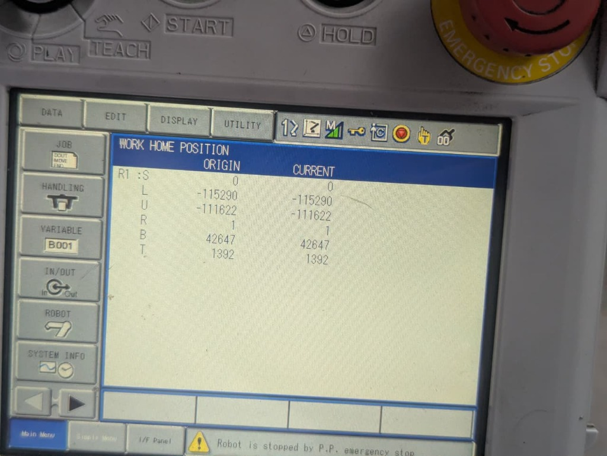
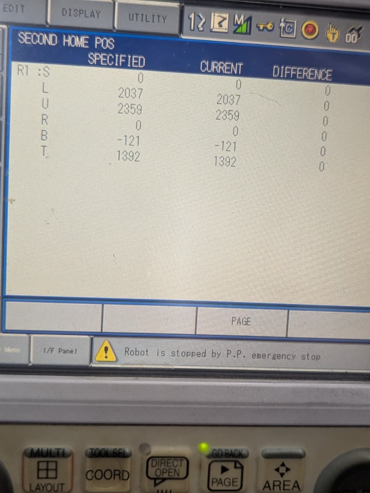
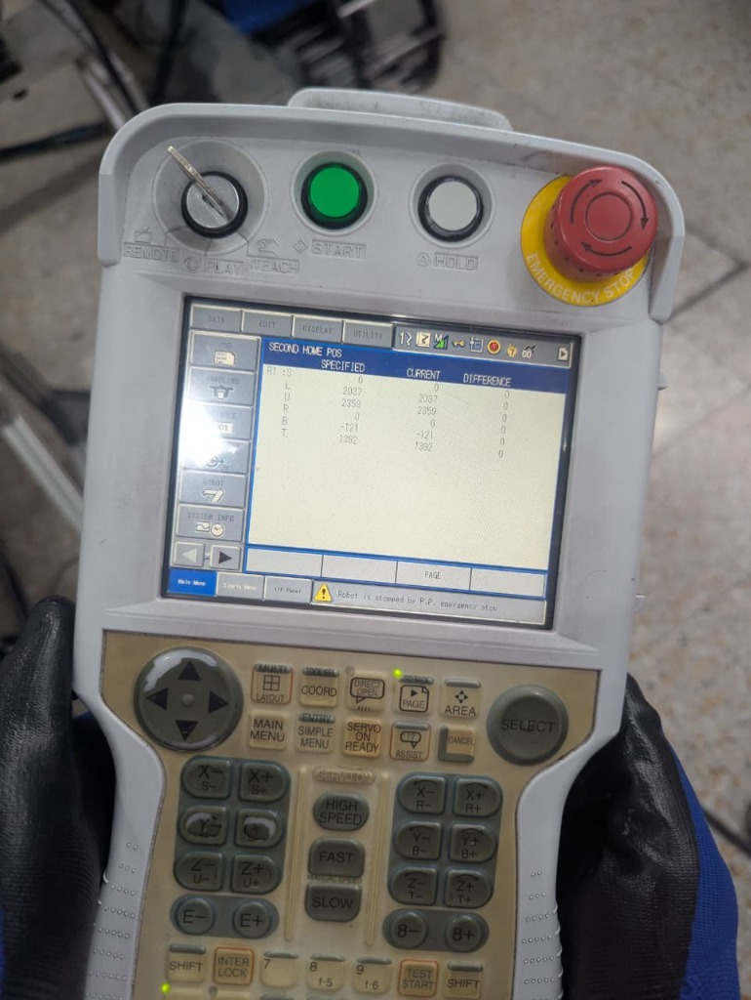
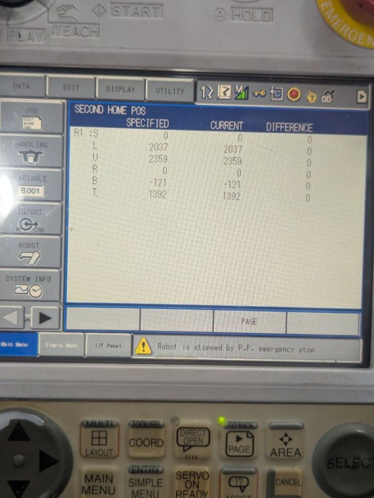
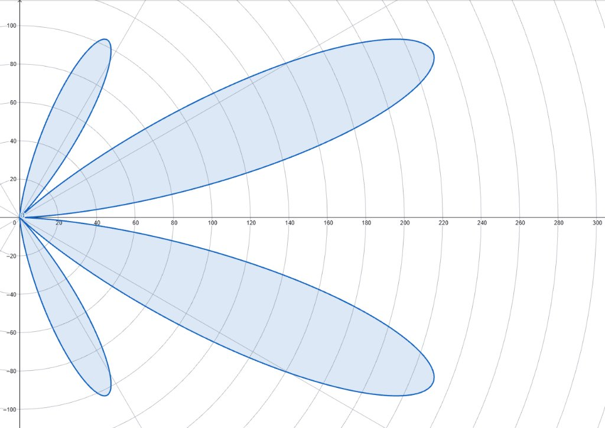
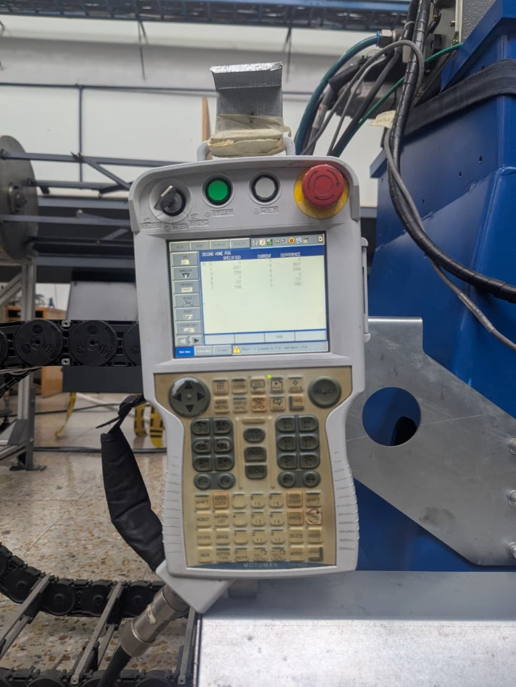
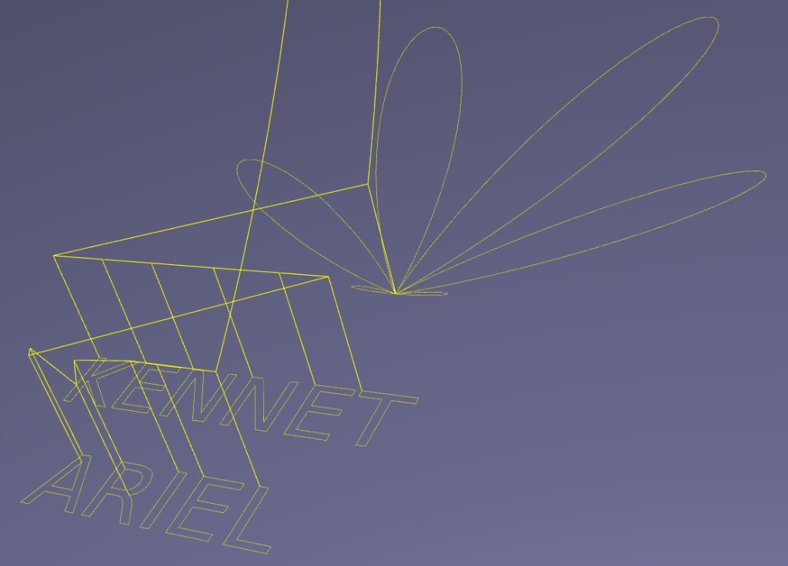

# Laboratorio 2 — Robótica Industrial: Análisis y Operación del Manipulador Motoman MH6
### Yaskawa Motoman MH6 · Controlador DX100 · RoboDK · Python API

<div align="center">

[](#)
[](#)
[](#)
[](#)

**Universidad Nacional de Colombia — Sede Bogotá**  
**Facultad de Ingeniería · Departamento de Ingeniería Mecánica y Mecatrónica · Sala CAM**  
**Asignatura:** Robótica (2026-II)  
**Grupo 5B:** Ariel Giovanni Cárdenas Santisteban · Kennet Jared Cruz Machuca

</div>

---

## Índice
1. [Descripción general y objetivos](#1-descripción-general-y-objetivos)
2. [Comparación técnica: Yaskawa Motoman MH6 vs. ABB IRB 140](#2-comparación-técnica-yaskawa-motoman-mh6-vs-abb-irb-140)
3. [Configuraciones iniciales del Motoman MH6 (home1 y home2)](#3-configuraciones-iniciales-del-motoman-mh6-home1-y-home2)
4. [Operación manual del manipulador Motoman MH6 (Teach Pendant DX100)](#4-operación-manual-del-manipulador-motoman-mh6-teach-pendant-dx100)
5. [Software RoboDK, comunicación con el MH6 y comparación con RobotStudio](#5-software-robodk-comunicación-con-el-mh6-y-comparación-con-robotstudio)
6. [Trayectoria polar, nombres y programación en Python](#6-trayectoria-polar-nombres-y-programación-en-python)
7. [Resultados, evidencias y video demostrativo](#7-resultados-evidencias-y-video-demostrativo)
8. [Aprendizajes, dificultades y conclusiones](#8-aprendizajes-dificultades-y-conclusiones)
9. [Referencias](#9-referencias)

---

## 1. Descripción general y objetivos

En esta práctica se analiza y opera el manipulador industrial **Yaskawa Motoman MH6** con controlador **DX100** en el Laboratorio **Sala CAM** de la Universidad Nacional de Colombia, contrastando sus capacidades técnicas y entorno de programación frente al **ABB IRB 140** empleado en el Laboratorio 1.

El desarrollo integra tres ejes complementarios: la operación manual desde el **Teach Pendant DX100** (modos de coordenadas, niveles de velocidad y configuraciones de referencia `Home1`/`Home2`), la validación geométrica de una trayectoria polar en **GeoGebra**, y su simulación y ejecución física en tiempo real desde PC mediante la API de **Python en RoboDK**, trazando **en el aire** sobre un plano virtual de referencia la curva polar junto con los nombres de los integrantes (**KENNET** y **ARIEL**).

### Objetivos y resultados de aprendizaje
- Comparar las capacidades técnicas y aplicaciones del manipulador **Yaskawa Motoman MH6** frente al **ABB IRB 140**.
- Identificar y diferenciar las configuraciones articulares iniciales **`home1`** y **`home2`** del Motoman MH6.
- Ejecutar movimientos manuales en modos **articular** y **cartesiano** (traslaciones y rotaciones en $X, Y, Z$) desde el Teach Pendant DX100.
- Comprender y conmutar los niveles de velocidad manual disponibles en el controlador DX100.
- Explicar el funcionamiento de **RoboDK**, su comunicación en modo remoto con el manipulador físico y sus diferencias frente a **RobotStudio**.
- Diseñar, validar matemáticamente en **GeoGebra**, simular en **RoboDK** y ejecutar físicamente en el aire una trayectoria polar y el trazado de los nombres del equipo comandados desde Python.

### Estructura del directorio

```text
Laboratorio No. 02 - Robótica Industrial Motoman MH6 y RoboDK/
├── README.MD                 # Informe y documentación principal de la práctica
├── Python/                   # Scripts de control en Python (RoboDK API)
│   └── Lab02_Kennet_Ariel.py # Trayectoria polar y trazado de nombres
└── Resultados/               # Evidencias del Teach Pendant DX100, celda, GeoGebra y RoboDK
    ├── home1_work_home_dx100.jpg
    ├── home2_second_home_dx100.jpg
    ├── teach_pendant_dx100.jpg
    ├── dx100_estado_velocidad.jpg
    ├── pendant_celda_mh6.jpg
    ├── trayectoria_polar_geogebra.jpg
    └── simulacion_robodk_trayectoria.jpg
```

---

## 2. Comparación técnica: Yaskawa Motoman MH6 vs. ABB IRB 140

| Característica | Yaskawa Motoman MH6 | ABB IRB 140 (`IRB 140-6/0.8`) | Observación / Diferencia |
|---|---|---|---|
| **Fabricante** | Yaskawa Motoman | ABB Robotics | Dos ecosistemas industriales distintos|
| **Controlador** | DX100 (Teach Pendant 6.5", Windows CE) | IRC5 (RobotWare, FlexPendant) | Ambos permiten operación manual, automática y remota |
| **Grados de libertad** | 6 (`S`, `L`, `U`, `R`, `B`, `T`) | 6 (`J1`–`J6`) | Misma arquitectura antropomórfica de 6 ejes |
| **Carga máxima (Payload)** | `6 kg` | `6 kg` | Igual capacidad |
| **Alcance máximo (H / V)** | `1422 mm` horizontal / `2486 mm` vertical | `810 mm` horizontal / `1243 mm` vertical | MH6 ofrece más alcance horizontal y una envolvente mas grande |
| **Repetibilidad de pose** | `±0.08 mm` | `0.03 mm` (ISO 9283; `RT = 0.08 mm`) | IRB 140 ofrece mayor precisión de posicionamiento repetitivo |
| **Velocidad máxima por eje** | `S: 220`, `L: 200`, `U: 220`, `R: 410`, `B: 410`, `T: 610 °/s` | `J1: 200`, `J2: 200`, `J3: 260`, `J4: 360`, `J5: 360`, `J6: 450 °/s` | MH6 es un poco más rápido en la base y en los ejes de la muñeca (`R, B, T`); IRB 140 solo lo supera en `J3` |
| **Masa del manipulador** | `~130 kg` | `98 kg` (sin cables) | IRB 140 es más compacto y liviano |
| **Opciones de montaje** | Piso, pared o techo (de cabeza) | Piso, invertido o pared en cualquier ángulo | Alta flexibilidad de instalación en ambos casos |
| **Grado de protección (IP)** | `IP54` (cuerpo) / `IP67` (muñeca) | `IP67` integral (opciones Foundry Plus 2, SteamWash y Clean Room ISO 6) | IRB 140 pensado para ambientes más exigentes |
| **Aplicaciones típicas** | Manipulación, alimentación de máquinas, ensamblaje, soldadura de arco, dispensado y empaque | Manipulación flexible, ensamblaje, pegado/dispensado, soldadura ligera, fundición y salas limpias | MH6 destaca en celdas amplias; IRB 140 en celdas compactas o ambientes severos |
---

## 3. Configuraciones iniciales del Motoman MH6 (`Home1` y `Home2`)

El manipulador Motoman MH6 cuenta con **encoders absolutos**, por lo que conserva automáticamente la referencia angular de cada articulación tras el encendido. Sobre esta base, el controlador **DX100** gestiona dos posiciones de referencia predefinidas expresadas internamente en **pulsos de encoder** para cada eje (`S, L, U, R, B, T`):

- **`Home1` (*Work Home Position*):** Postura de reposo y guardado en la que el manipulador **se recoge sobre sí mismo**, plegando sus eslabones sobre la columna base para minimizar el espacio ocupado en la celda y reducir el par estático en paradas prolongadas.
- **`Home2` (*Second Home Position*):** Postura operativa de referencia secundaria con **configuración en L invertida**, manteniendo el brazo elevado y la brida orientada hacia la zona frontal de operación, lista para iniciar trayectorias sin interferir con la base.

| Eje Motoman | Articulación | `Home1` — *Work Home* (pulsos `ORIGIN`) | `Home2` — *Second Home* (pulsos `SPECIFIED`) | Interpretación geométrica |
|:---:|---|:---:|:---:|---|
| **`S`** | Base (`S-head`) | `0` | `0` | Base centrada al frente en ambas posturas (`ORIGIN = CURRENT = 0`) |
| **`L`** | Brazo inferior (`L-arm`) | `-115290` | `2037` | Fuertemente replegado hacia atrás en `Home1` vs. casi vertical/frontal en `Home2` |
| **`U`** | Brazo superior (`U-arm`) | `-111622` | `2359` | Plegado sobre la columna en `Home1` vs. extendido en L invertida en `Home2` |
| **`R`** | Rotación muñeca (`Wrist`) | `1` | `0` | Antebrazo centrado sin torsión acumulada |
| **`B`** | Inclinación muñeca (`Wrist`) | `42647` | `-121` | Acompaña el plegado compacto en `Home1`; orienta la brida operativamente en `Home2` |
| **`T`** | Giro flange (`Wrist Flange`) | `1392` | `1392` | Giro de brida de referencia equivalente en ambas posturas |

> [!NOTE]
> **Verificación directa en Sala CAM (con el controlador DX100):** Todos los pulsos mostrados corresponden a las lecturas registradas en el Teach Pendant del laboratorio, verificando `ORIGIN = CURRENT` en `Home1` (*Work Home Position*) y `DIFFERENCE = 0` (`SPECIFIED = CURRENT`) en `Home2` (*Second Home Pos*).

- **Diferencias cinemáticas y geométricas:**
  - **Envolvente y despeje respecto a la base:** En `Home1`, los eslabones `L` (`-115290`) y `U` (`-111622`) se pliegan verticalmente sobre la columna central reduciendo el radio de interferencia en la celda. En `Home2`, el brazo se proyecta en L invertida hacia el frente, alejando la muñeca y el efector de la estructura propia del robot.
  - **Orientación y distancia a la zona de trabajo:** `Home2` mantiene la herramienta a altura operativa y orientada hacia la zona frontal de trabajo en el aire, reduciendo el desplazamiento articular previo al primer punto de la trayectoria; `Home1` exige un despliegue amplio de `L` y `U` antes de aproximarse al marco de referencia.
  - **Torque estático en reposo:** Al acercar los centros de masa al eje de la columna, `Home1` reduce el momento gravitacional sostenido sobre los ejes `L` y `U` cuando el manipulador permanece detenido fuera de ciclo.
- **¿Cuál posición es mejor? Justificación:**
  - **`Home2` (*Second Home*) es mejor para iniciar y cerrar ciclos de operación**, ya que la configuración en L invertida deja el efector preorientado hacia la zona de trabajo, acorta el recorrido hacia el punto inicial de trazado y aleja el brazo de la base disminuyendo el riesgo de autocolisión al arrancar movimientos `MoveJ`/`MoveL`.
  - **`Home1` (*Work Home*) es preferible para reposo prolongado y seguridad espacial**, pues al recoger los eslabones sobre sí mismo minimiza el espacio ocupado en la Sala CAM y disminuye la carga mecánica estática sobre las articulaciones.

| `Home1` (*Work Home Position*) en DX100 | `Home2` (*Second Home Pos*) en DX100 |
|:---:|:---:|
|  |  |
| *Figura 3.1: Configuración `Home1` (`ORIGIN = CURRENT`) verificada en el Teach Pendant.* | *Figura 3.2: Configuración `Home2` (`SPECIFIED = CURRENT`, `DIFFERENCE = 0`) en el Teach Pendant.* |

---

## 4. Operación manual del manipulador Motoman MH6 (Teach Pendant DX100)

### 4.1 Encendido, modos de operación y seguridad básica
- **Selector de modo (`[MODE]`):** Llave selectora ubicada en la parte superior izquierda del Teach Pendant con tres posiciones:
  - **`TEACH`:** Habilita la operación manual desde el Teach Pendant y la edición/enseñanza de puntos y programas.
  - **`PLAY`:** Permite ejecutar de manera automática los programas almacenados localmente en el controlador DX100.
  - **`REMOTE`:** Cede el control a señales externas o a un computador en red; es el modo obligatorio para comandar el robot en tiempo real desde RoboDK.
- **Activación de servos (`Enable Switch` y `[SERVO ON READY]`):** El *Enable Switch* (Deadman Switch) trasero del Teach Pendant cuenta con **3 posiciones de seguridad**:
  1. *Suelto (sin presionar):* energía de servomotores desactivada (`OFF`).
  2. *Presión ligera intermedia:* habilita los servomotores (`ON`) permitiendo mover el manipulador en modo `TEACH`.
  3. *Presión firme a fondo (reacción ante pánico):* corta inmediatamente la potencia de los servos (`OFF`) para detener cualquier movimiento.
  Para energizar el brazo manualmente se habilita **`[SERVO ON READY]`** y se sostiene el *Enable Switch* en la posición intermedia.
- **Parada de emergencia (`Emergency Stop`):** Pulsador tipo hongo de color rojo ubicado en la esquina superior derecha del Teach Pendant (y en el gabinete del DX100). Al oprimirlo se interrumpe de inmediato la potencia a los servos y el indicador de estado muestra `Emergency Stop`. Para rearmar el sistema se debe girar el botón en el sentido de las flechas hasta liberarlo, limpiar alarmas si aplica y reenergizar los servos.

### 4.2 Cambio de coordenadas y movimiento manual (Articulaciones y Cartesiano)

Para conmutar el sistema de coordenadas manual en el DX100 se utiliza la tecla **`[COORD]`**, la cual alterna entre los modos visibles en el área de estado (*Status display area*, posición `B. Operation coordinate system`):
1. **`Joint Coordinates`** (movimiento independiente de articulaciones `S, L, U, R, B, T`).
2. **`Cartesian Coordinates`** (traslaciones lineales `X, Y, Z` y rotaciones `Rx, Ry, Rz` respecto a la base).
3. **`Cylindrical Coordinates`**.
4. **`Tool Coordinates`** (movimiento respecto al sistema de la herramienta).
5. **`User Coordinates`** (movimiento respecto a un marco de usuario).

| Teclas de eje (*Axis keys*) | Modo `Joint` (Articulaciones) | Modo `Cartesian` (Traslación / Rotación) |
|:---:|:---:|:---:|
| `X-` / `X+` (Básicos) | Eje `S` (Base) | Traslación lineal del TCP sobre el eje `X` de la base |
| `Y-` / `Y+` (Básicos) | Eje `L` (Brazo inferior) | Traslación lineal del TCP sobre el eje `Y` de la base |
| `Z-` / `Z+` (Básicos) | Eje `U` (Brazo superior) | Traslación lineal del TCP sobre el eje `Z` de la base |
| `X-` / `X+` (Muñeca) | Eje `R` (Rotación muñeca) | Rotación de la herramienta alrededor de `X` (`Rx`, TCP fijo) |
| `Y-` / `Y+` (Muñeca) | Eje `B` (Flexión muñeca) | Rotación de la herramienta alrededor de `Y` (`Ry`, TCP fijo) |
| `Z-` / `Z+` (Muñeca) | Eje `T` (Giro flange) | Rotación de la herramienta alrededor de `Z` (`Rz`, TCP fijo) |

> [!NOTE]
> En la documentación del DX100, el modo `Cartesian` también se denomina **`RECTANGULAR`** o **`XYZ`**. En este modo, las teclas básicas trasladan el TCP manteniendo fija la orientación de la herramienta, mientras que las teclas de muñeca rotan la orientación (`Rx, Ry, Rz`) manteniendo fijo el punto TCP.

**Procedimiento paso a paso en el Teach Pendant DX100:**
1. Girar el selector `[MODE]` a **`TEACH`** para habilitar la operación manual.
2. Mantener presionado el **`Enable Switch`** (Deadman Switch) en su posición intermedia y verificar la activación de servos (`[SERVO ON READY]`).
3. Presionar la tecla **`[COORD]`** hasta visualizar en el *Status display area* (`B`) el modo **`Joint`** (ícono de brazo articulado, para mover `S, L, U, R, B, T` de forma independiente) o **`Cartesian`** (ícono de ejes con cuadrado amarillo, para trasladar en `X, Y, Z` con las teclas básicas y rotar en `Rx, Ry, Rz` con las teclas de muñeca).
4. Seleccionar el nivel de velocidad manual (`FAST` / `SLOW`) y pulsar de forma sostenida la tecla de eje deseada sin soltar el `Enable Switch`.

<div align="center">
  <br>
  <em>Figura 4.1: Teach Pendant DX100 en Sala CAM mostrando selector <code>[MODE]</code>, Emergency Stop, <code>[COORD]</code>, <code>[SERVO ON READY]</code>, teclas de velocidad y ejes.</em>
</div><br>

### 4.3 Niveles de velocidad manual

- **¿Cómo se hace el cambio entre niveles de velocidad?**  
  Mediante las teclas **`MANUAL SPEED`** (**`FAST`** para incrementar y **`SLOW`** para disminuir el nivel). Se recomienda usar `High`/`Medium` en traslados amplios en zona despejada y cambiar a `Low`/`Inching` para ajustes finos o maniobras de precisión cerca de obstáculos.
- **¿Cómo se identifica en pantalla el nivel establecido?**  
  En el **área de estado (*Status display area*)** ubicada en la parte superior de la pantalla del DX100 (indicador `C. Manual speed`), aparece un ícono similar a barras de señal de datos compuesto por **tres barritas verticales progresivas en verde** junto a la letra correspondiente al nivel activo (`I`, `L`, `M` o `H`):

| Nivel de velocidad | Ícono en pantalla (`C. Manual speed`) | Velocidad relativa / uso típico | Descripción |
|---|:---:|---|---|
| **`Inching`** | `I` + 0 barritas verdes (3 vacías) | Ajuste fino paso a paso | Desplazamiento incremental mínimo para ajustes de alta precisión. |
| **`Low Speed`** | `L` + 1 barrita verde | Aproximación segura | Movimiento lento y controlado en zonas cercanas a obstáculos o límites. |
| **`Medium Speed`** | `M` + 2 barritas verdes | Desplazamientos intermedios | Velocidad moderada para reposicionamiento general dentro de la celda. |
| **`High Speed`** | `H` + 3 barritas verdes | Traslados amplios en zona libre | Máxima velocidad manual; usar únicamente con trayectoria despejada. |

<div align="center">
  <br>
  <em>Figura 4.2: Barra de estado del Teach Pendant DX100 mostrando el modo de coordenadas <code>Joint</code> y el indicador de velocidad manual <code>M</code> con dos barritas verdes activas.</em>
</div><br>

---

## 5. Software RoboDK, comunicación con el MH6 y comparación con RobotStudio

### 5.1 Funcionalidades principales de RoboDK y cómo mueve el manipulador
**RoboDK** es un entorno multi-marca de simulación offline y programación de robots industriales. Entre sus funciones principales se encuentran el modelado 3D de celdas, la definición de sistemas de referencia (*Frames*) y herramientas (TCP), la detección de colisiones y singularidades, la generación de trayectorias desde scripts o CAD/CAM, la exportación de programas nativos mediante postprocesadores (por ejemplo `.jbi` en INFORM para Motoman) y el control en línea desde PC.

**¿Qué hace RoboDK para mover el manipulador?**  
A partir de los objetivos cartesianos o articulares definidos en el script (`MoveJ`, `MoveL`), RoboDK resuelve la **cinemática inversa** del modelo del Motoman MH6, verifica límites articulares y singularidades, interpola los puntos intermedios respetando los parámetros de velocidad (`setSpeed`) y suavizado (`setRounding`), y envía los comandos resultantes ya sea al gemelo virtual (simulación) o al driver de comunicación en tiempo real para ejecutarlos en el controlador físico.

### 5.2 Comunicación RoboDK ↔ Motoman MH6 (DX100)
La comunicación entre el computador y el manipulador se realiza mediante enlace **Ethernet (TCP/UDP sobre IP)** conectando el PC al puerto LAN del controlador **DX100** dentro de la misma subred. Para permitir el comando externo en tiempo real:
1. En el Teach Pendant del DX100 se posiciona el selector `[MODE]` en **`REMOTE`**.
2. En RoboDK se configura la dirección IP del controlador y el driver de comunicación **High-Speed Ethernet Server (`MotomanHSE`)** para Yaskawa/Motoman.
3. Desde [`Lab02_Kennet_Ariel.py`](./Python/Lab02_Kennet_Ariel.py) (líneas 16–24), la API establece y valida la sesión en línea mediante `robot.Connect()` y `robot.ConnectedState()`, enviando cada instrucción `MoveJ`/`MoveL` en tiempo real al manipulador físico.

### 5.3 Comparación entre RoboDK y RobotStudio

| Criterio | RoboDK | RobotStudio |
|---|---|---|
| **Fabricantes y robots soportados** | Multi-marca (Yaskawa/Motoman, ABB, KUKA, FANUC, UR, Epson, etc.) | Exclusivo para manipuladores **ABB** |
| **Lenguaje / API de programación** | Python API (`robodk`), C#, C++, MATLAB y postprocesadores a lenguaje nativo | Lenguaje nativo **RAPID** y SDK de ABB |
| **Fidelidad de simulación del controlador** | Cinemática y trayectorias aproximadas por driver/postprocesador (no emula el firmware real completo) | Controlador virtual **IRC5** idéntico al real (tiempos de ciclo, lógica E/S, interrupciones y señales exactas) |
| **Control online desde PC** | Nativo (*Run on Robot* mediante drivers como `MotomanHSE`) | Enfoque principal de programación/despliegue offline y monitoreo en línea hacia IRC5 |
| **Ventajas principales** | Versatilidad multi-marca, integración rápida con Python/CAD y curva de aprendizaje ágil | Precisión exacta de tiempos, dinámica, cinemática y configuración real de E/S en ABB |
| **Limitaciones** | Menor fidelidad en lógicas de E/S complejas, variadores o retardos internos de cada controlador | Limitado al ecosistema ABB; requiere mayor configuración inicial del entorno del controlador |
| **Aplicaciones recomendadas** | Prototipado rápido, trayectorias desde Python/CAD, celdas heterogéneas y docencia multi-robot | Celdas industriales ABB completas con E/S físicas, sincronización de periféricos y puesta en marcha en planta |

### 5.4 Significado y valoración de cada herramienta para el equipo
A partir de la experiencia acumulada entre el Laboratorio 1 y el Laboratorio 2, **RobotStudio** representa para el equipo el entorno especializado de ingeniería y puesta en marcha industrial para un fabricante específico (ABB), indispensable cuando se requiere exactitud en tiempos, configuración real de módulos de E/S digitales y validación fiel del controlador antes de ir a planta. Por su parte, **RoboDK** representa una plataforma ágil, abierta y multi-marca que facilita enormemente conectar la robótica con cálculo matemático y generación algorítmica de trayectorias en **Python**, acelerando la experimentación y el control directo desde PC sobre distintos manipuladores como el Motoman MH6.

---

## 6. Trayectoria polar, nombres y programación en Python

### 6.1 Formulación matemática de la trayectoria polar y validación en GeoGebra

En el script [`Lab02_Kennet_Ariel.py`](./Python/Lab02_Kennet_Ariel.py) (líneas 80–93), la curva polar ejecutada por el manipulador se define mediante:

$$r(\theta) = A \sin^2(k\theta)\cos(\theta), \qquad \theta \in [0, \pi]$$

$$x(\theta) = r(\theta)\cos(\theta), \qquad y(\theta) = r(\theta)\sin(\theta)$$

| Parámetro en código | Valor | Significado |
|---|---|---|
| `A` | `250` mm | Amplitud radial máxima de la figura |
| `k` | `5` | Parámetro de frecuencia angular (pétalos) |
| `full_turn` | `math.pi` ($\pi$ rad) | Barrido angular $\theta \in [0, \pi]$ |
| `num_points` | `220` | Número de intervalos ($221$ puntos discretizados, $i = 0 \dots 220$) |
| `z_surface` | `0` mm | Plano virtual de trazado en el aire respecto a `Frame_from_Target1` |
| `z_safe` | `50` mm | Desplazamiento vertical de seguridad (`z_surface - z_safe = -50` mm) |
| `robot.setSpeed(...)` | `300` | Velocidad lineal (`mm/s`) y articular (`deg/s`) |
| `robot.setRounding(...)` | `5` / `2` | Radio de suavizado (*blending*): `5` mm para la figura polar y `2` mm para las letras |

**Validación matemática en GeoGebra:**  
Al graficar la ecuación en GeoGebra con $A = 250$ mm, $k = 5$ y $\theta \in [0, \pi]$, se verifica una figura simétrica respecto al eje $X$ contenida en el semiplano $x \ge 0$, conformada por cuatro lóbulos: dos lóbulos principales con alcance radial cercano a $230\text{ mm}$ ($x \le 220\text{ mm}$) y dos lóbulos secundarios cercanos a $100\text{ mm}$ de radio, con una extensión vertical aproximada de $[-95, +95]\text{ mm}$, dimensiones plenamente contenidas dentro del espacio de trabajo del Motoman MH6.

<div align="center">
  <br>
  <em>Figura 6.1: Gráfica polar de validación en GeoGebra para <code>r(θ) = 250·sin²(5θ)·cos(θ)</code> en <code>[0, π]</code>.</em>
</div><br>

### 6.2 Configuración en RoboDK (Frame, Home y herramienta)

El script vincula los elementos de la estación mediante los siguientes identificadores:
- **Marco de referencia virtual (`Frame_from_Target1`):** Definido en la estación de RoboDK (`frame_name = "Frame_from_Target1"`, `robot.setPoseFrame(frame)`) para ejecutar la trayectoria **en el aire** en el espacio frontal del manipulador.
- **Pose segura inicial/final:** `target_home = "Target Home"` (`t_h`).
- **Herramienta activa y encoders absolutos:** Se utilizó directamente la **herramienta propia ya configurada en el manipulador** (`robot.setPoseTool(robot.PoseTool())`), sin diseñar ni acoplar efector adicional. Además, gracias a sus **encoders absolutos**, el Motoman MH6 mantiene sus referencias articulares listas para operar tras el encendido.

### 6.3 Trazado de los nombres de los integrantes (KENNET y ARIEL)

Debajo de la trayectoria polar, el programa dibuja los nombres **KENNET** y **ARIEL** usando la lista `trazos_nombres` (línea 106), conformada por **13 contornos poligonales cerrados** (`6` trazos para **KENNET** y `7` trazos para **ARIEL**).

- **Suavizado:** Se reduce a `robot.setRounding(2)` para mantener esquinas definidas en la tipografía.
- **Origen de puntos y transformación geométrica (`transformar_punto(px, py)`):** Los contornos 2D de `trazos_nombres` se obtuvieron previamente mediante otro script auxiliar en Python. Como al proyectarlos sobre `Frame_from_Target1` los nombres aparecieron volteados respecto a la figura polar, se aplicó la siguiente transformación en tres pasos:
  1. Corrección de espejo en $Y$ y centrado local: $x_{\text{temp}} = p_x + 30$, $y_{\text{temp}} = -p_y - 340$.
  2. Rotación de $\text{ANGULO} = 90^\circ$ ($\pi/2\text{ rad}$): $x_{\text{rot}} = x_{\text{temp}}\cos\alpha - y_{\text{temp}}\sin\alpha$, $y_{\text{rot}} = x_{\text{temp}}\sin\alpha + y_{\text{temp}}\cos\alpha$.
  3. Traslación final bajo la figura polar: `POS_X = -90`, `POS_Y = -40`.
- **Estrategia de movimiento:** Para cada trazo, el robot se aproxima por encima (`z_surface - z_safe = -50`), desciende al plano virtual (`z_surface = 0`), recorre todos los vértices con `MoveL` y se eleva nuevamente al concluir el contorno antes de pasar al siguiente.

### 6.4 Diagrama de flujo de acciones del robot


### 6.5 Arquitectura del script y anexo de código

El código fuente completo se adjunta como anexo en [`Lab02_Kennet_Ariel.py`](./Python/Lab02_Kennet_Ariel.py):

| Bloque | Líneas | Función principal |
|---|---|---|
| **1. Conexión e inicialización** | `1–25` | Instancia `Robolink()`, selección del robot y bloque de conexión física `Connect()` / `ConnectedState()`. |
| **2. Frame, Home y parámetros de movimiento** | `28–47` | Carga `Frame_from_Target1` y `Target Home`, fija marco, herramienta, `setSpeed(300)` y `setRounding(5)`. |
| **3. Parámetros de la trayectoria polar** | `50–56` | Define `num_points = 220`, `A = 250`, `k = 5`, `z_surface = 0` y `z_safe = 50`. |
| **4. Posicionamiento inicial** | `59–70` | Lleva el robot a `Target Home`, aproxima por altura segura al origen y desciende a `z_surface`. |
| **5. Ejecución de trayectoria polar** | `73–99` | Calcula $r(\theta)$, $(x, y)$ en $\theta \in [0, \pi]$ y ejecuta la curva con `MoveL`, finalizando con retracción segura. |
| **6. Trazado de nombres y retorno a Home** | `102–153` | Ajusta `setRounding(2)`, transforma los 13 trazos de `KENNET` y `ARIEL`, los dibuja con `MoveL` y regresa a `Target Home` con `MoveJ`. |

**Extracto principal de control y generación de trayectorias (`Python/Lab02_Kennet_Ariel.py`):**

```python
from robodk.robolink import *
from robodk.robomath import *
import math

RDK = Robolink()
robot = RDK.ItemUserPick("Selecciona un robot", ITEM_TYPE_ROBOT)
# robot.Connect()  # Descomentado durante la ejecución física en modo REMOTE

frame = RDK.Item("Frame_from_Target1", ITEM_TYPE_FRAME)
t_h = RDK.Item("Target Home", ITEM_TYPE_TARGET)
robot.setPoseFrame(frame)
robot.setPoseTool(robot.PoseTool())
robot.setSpeed(300)
robot.setRounding(5)

num_points = 220
A = 250
k = 5
z_surface = 0
z_safe = 50

robot.MoveJ(t_h)
robot.MoveJ(transl(0, 0, z_surface - z_safe))
robot.MoveL(transl(0, 0, z_surface))

full_turn = math.pi
for i in range(num_points + 1):
    t = i / num_points
    theta = full_turn * t
    r = A * math.sin(k * theta) * math.sin(k * theta) * math.cos(theta)
    x = r * math.cos(theta)
    y = r * math.sin(theta)
    robot.MoveL(transl(x, y, z_surface))

robot.MoveL(transl(x, y, z_surface - z_safe))

robot.setRounding(2)
# trazos_nombres = [...]  # 13 contornos cerrados para KENNET y ARIEL
POS_X = -90
POS_Y = -40
ANGULO = math.radians(90)
cos_a = math.cos(ANGULO)
sin_a = math.sin(ANGULO)

def transformar_punto(px, py):
    x_temp = px + 30
    y_temp = -py - 340
    x_rot = x_temp * cos_a - y_temp * sin_a
    y_rot = x_temp * sin_a + y_temp * cos_a
    return x_rot + POS_X, y_rot + POS_Y

for trazo in trazos_nombres:
    if len(trazo) == 0:
        continue
    x0, y0 = transformar_punto(trazo[0][0], trazo[0][1])
    robot.MoveL(transl(x0, y0, z_surface - z_safe))
    for px, py in trazo:
        nx, ny = transformar_punto(px, py)
        robot.MoveL(transl(nx, ny, z_surface))
    xf, yf = transformar_punto(trazo[-1][0], trazo[-1][1])
    robot.MoveL(transl(xf, yf, z_surface - z_safe))

robot.setRounding(5)
robot.MoveJ(t_h)
```

---

## 7. Resultados, evidencias y video demostrativo

### 7.1 Evidencias gráficas (RoboDK y celda en Sala CAM)

| Montaje en Sala CAM | Simulación en RoboDK |
|:---:|:---:|
|  |  |
| *Figura 7.1: Teach Pendant DX100 acoplado en la celda del Motoman MH6 en Sala CAM.* | *Figura 7.2: Simulación de la trayectoria polar y los nombres en RoboDK.* |

### 7.2 Video demostrativo (YouTube — Canal oficial LabSIR)

A continuación se presenta el registro audiovisual de la simulación en RoboDK y la ejecución física en el robot real (incluyendo la introducción oficial del Laboratorio LabSIR):

- **Título:** `Laboratorio 02: Simulación y Operación del Manipulador Motoman MH6 | Equipo 5B | 2026-II`
- **Contenido abarcado:**
  - Validación matemática de la trayectoria polar en GeoGebra.
  - Configuración del sistema de referencia (Frame), herramienta y simulación de trayectoria en RoboDK.
  - Ejecución física en tiempo real de la trayectoria polar sobre el plano de trabajo.
  - Trazado de los nombres de los integrantes (**KENNET** y **ARIEL**) mediante líneas e interpolaciones.

<div align="center">

*[Completar: insertar miniatura y enlace al video una vez publicado en el canal oficial de YouTube del Laboratorio LabSIR]*

</div>

---

## 8. Aprendizajes, dificultades y conclusiones

### Aprendizajes clave
- **Control online multi-marca con RoboDK y Python API:** Comprensión práctica de cómo traducir ecuaciones paramétricas polares y contornos vectoriales a instrucciones `MoveJ`/`MoveL` ejecutadas directamente sobre el manipulador físico mediante enlace Ethernet en modo `REMOTE`.
- **Operación manual en Teach Pendant DX100:** Manejo de seguridad básica (`Enable Switch` de 3 posiciones, `Emergency Stop`), conmutación de sistemas de coordenadas con `[COORD]`, ajuste de velocidad manual (`FAST`/`SLOW`) e interpretación de las posturas de referencia `Home1` y `Home2`.
- **Validación previa de trayectorias:** Verificación matemática en **GeoGebra** y cinemática en **RoboDK** antes de energizar y comandar el brazo en tiempo real en el espacio de trabajo (trazado en el aire).

### Dificultades encontradas y soluciones implementadas
- **Orientación volteada de los nombres respecto a la figura polar:**
  - *Dificultad:* Al generar los contornos 2D de `KENNET` y `ARIEL` desde un script auxiliar de Python y proyectarlos sobre `Frame_from_Target1`, el texto aparecía invertido/volteado frente al sistema de coordenadas de la curva polar.
  - *Solución:* Se implementó la función `transformar_punto(px, py)` aplicando corrección de espejo en $Y$, rotación de `ANGULO = 90°` y traslación (`POS_X = -90`, `POS_Y = -40`) para alinear el texto debajo de la figura.
- **Compromiso entre fluidez de curva y nitidez tipográfica:**
  - *Dificultad:* Un radio de suavizado amplio (`setRounding(5)`) favorece la continuidad de la trayectoria polar, pero redondea excesivamente las esquinas agudas en las letras.
  - *Solución:* Se mantuvo `robot.setRounding(5)` para la trayectoria polar y se redujo dinámicamente a `robot.setRounding(2)` antes de ejecutar `trazos_nombres`, restaurándolo a `5` al retornar a `Target Home`.

### Conclusiones
- El **Yaskawa Motoman MH6** (`1422 mm` de alcance, `±0.08 mm` de repetibilidad) resulta más versátil que el **ABB IRB 140** (`810 mm`, `0.03 mm`) en celdas mas amplias donde prima el alcance sobre el posicionamiento preciso.
- En el controlador **DX100**, **`Home2` (*Second Home*)** es la postura más conveniente para iniciar y cerrar rutinas por su configuración en L invertida orientada hacia la zona de operación, mientras que **`Home1` (*Work Home*)** cumple mejor el rol de parqueo compacto y seguro.
- La integración **GeoGebra + RoboDK Python API** agiliza significativamente el desarrollo de trayectorias analíticas frente a la programación manual punto a punto, manteniendo la verificación previa en el entorno RoboDK.

---

## 9. Referencias
- Universidad Nacional de Colombia — Curso de Robótica (2026). *Guía Laboratorio No. 02 — Robótica Industrial: Análisis y Operación del Manipulador Motoman MH6*.
- Ramírez, R. E., & Cárdenas, P. F. *Programación y Operación Básica — Teach Pendant DX100, Manipulador Motoman MH6*. Departamento de Ingeniería Mecánica y Mecatrónica, Universidad Nacional de Colombia.
- Yaskawa Motoman. *Referencia básica de programación y operación — Controlador DX100 / Manipulador Motoman MH6* (manual técnico de referencia).
- ABB Robotics (2020). *Product specification — IRB 140-6/0.8 / IRB 140T-6/0.8* (Document ID: 3HAC041346-001, Rev. Q).
- RoboDK Inc. *RoboDK Python API Documentation (`robodk.robolink`, `robodk.robomath`)*.
