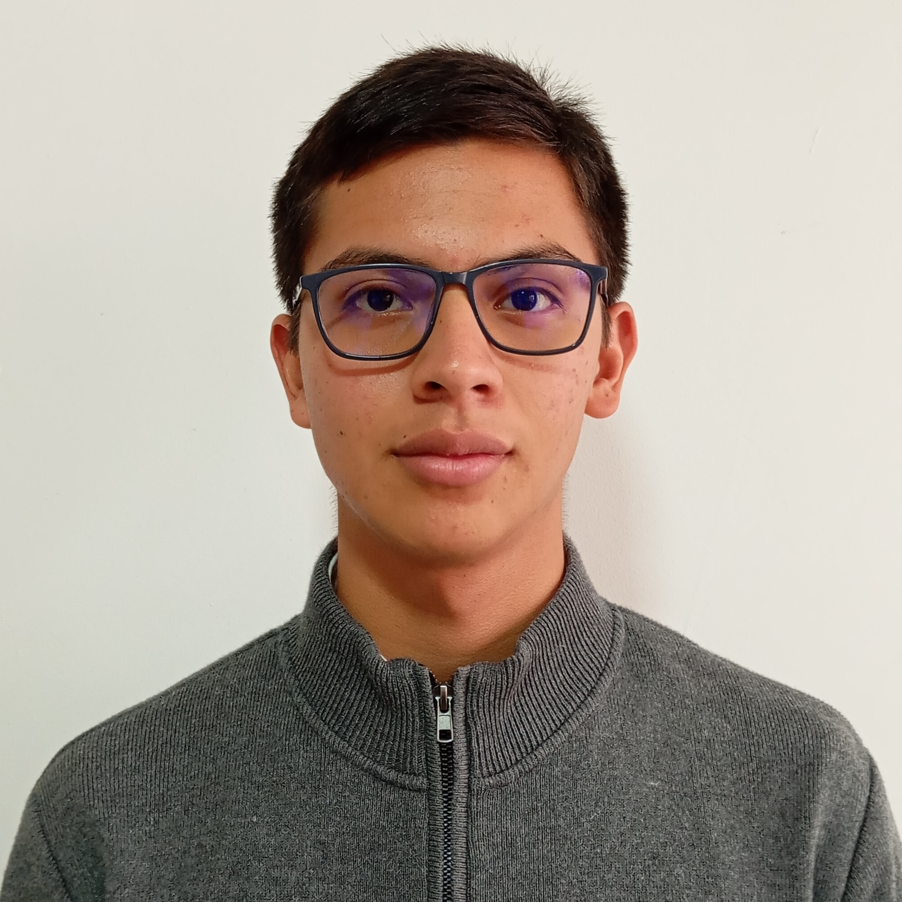

<picture>
    <source srcset="https://imgur.com/5bYAzsb.png" media="(prefers-color-scheme: dark)">
    <source srcset="https://imgur.com/Os03JoE.png" media="(prefers-color-scheme: light)">
    
</picture>

<h3>Curso de Robótica 2026-II</h3>

<h1>Compilado de Informes de Laboratorio de Robótica</h1>

<h2>Profesores:  Pedro Fabián Cárdenas Herrera   Manuel Felipe Carranza Montenegro</h2>

<h4>Ariel Giovanni Cardenas Santisteban 
    Kennet Jared Cruz Machuc</h4>

  
  
  
  
  
  
  
  
  
  
  
  
  

---

## Descripción

Este repositorio corresponde al desarrollo de las actividades del curso de **Robótica 2026-I**.  
Aquí se documentan los laboratorios, avances, resultados y la presentación de los integrantes del equipo.

---

## Objetivos del repositorio

- Organizar el desarrollo de los laboratorios del curso.
- Documentar procedimientos, resultados y evidencias.
- Presentar formalmente a los integrantes del equipo.
- Mantener una estructura clara y ordenada para la evaluación.

---

## Integrantes del equipo

### Integrante 1

    

- **Nombre completo:** Ariel Giovanni Cardenas Santisteban
- **Carrera:** Ingeniería Mecatrónica
- **Correo institucional:** arcardenass@unal.edu.co
- **Usuario de GitHub:** [ArielDcg](https://github.com/ArielDcg)
- **Rol en el equipo:** Documentación, Programación, Control
- **Intereses:** Automatización de Procesos, Robótica Industrial, Teoría de Control
- **Descripción breve:**  
Soy estudiante de Ingeniería Mecatrónica orientándome hacia la maestría en Automatización Industrial para solucionar problemas reales en el sector cafetero. Mi objetivo es aportar a la renovación tecnológica agrícola de Ecuador, mi país natal, y de Colombia, país al que agradezco mi crecimiento académico. Busco automatizar líneas de transformación para exportación masiva, impulsado por mi interés en la investigación en robótica y el desarrollo de la teoría de control.

---

### Integrante 2

    

- **Nombre completo:** Nombre Apellido
- **Carrera:** Ingeniería Mecatrónica
- **Correo institucional:** nombre@unal.edu.co
- **Usuario de GitHub:** [usuariogithub](https://github.com/usuariogithub)
- **Rol en el equipo:** Ej. Modelado, programación, control
- **Intereses:** Manipulación, ROS 2, control de robots
- **Descripción breve:**  
  Escribe aquí una breve presentación personal y académica del integrante.